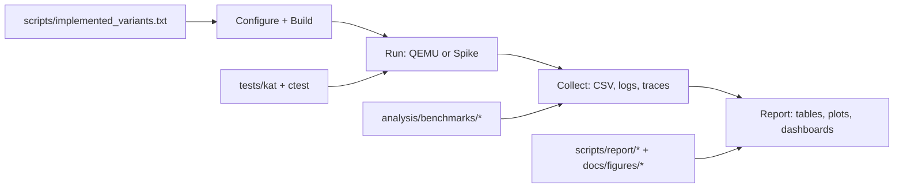

# HQC-RISCV Directory Architecture

## Overview

hqc-riscv is a bare-metal RISC-V evaluation framework for HQC (Hamming Quasi-Cyclic) KEM. It compares scalar and vectorized polynomial multiplication variants, validates correctness with KATs, and collects benchmark, profiling, and reporting artifacts.

## Optimization Tracks (Current)

| Track            | Component           | Strategy                         | Main Source                                                          |
| ---------------- | ------------------- | -------------------------------- | -------------------------------------------------------------------- |
| baseline_ref     | Polynomial multiply | Vendor Karatsuba reference       | [src/ref/gf2x.c](../vendor/hqc-ref/src/ref/gf2x.c)                   |
| karatsuba_zbc    | Polynomial multiply | Scalar CLMUL/CLMULH base cases   | [gf2x_clmul.c](../src/poly_mul/scalar/karatsuba_zbc/gf2x_clmul.c)    |
| fafft_zbc        | Polynomial multiply | FAFFT + scalar Zbc + RVV helpers | [fafft.c](../src/poly_mul/scalar/fafft_zbc/fafft.c)                  |
| hybrid           | Polynomial multiply | Karatsuba outer + FAFFT inner    | [hybrid.c](../src/poly_mul/scalar/hybrid_zbc/hybrid.c)               |
| fafft_zvbc       | Polynomial multiply | Vector CLMUL butterflies (Zvbc)  | [fafft_vclmul.c](../src/poly_mul/vector/fafft_zvbc/fafft_vclmul.c)   |
| karatsuba_zvbc   | Polynomial multiply | Vectorized Karatsuba path (Zvbc) | [gf2x_vclmul.c](../src/poly_mul/vector/karatsuba_zvbc/gf2x_vclmul.c) |
| keccak_rvv       | Keccak/SHAKE        | RVV Keccak-f[1600] path          | [fips202_rvv.c](../src/keccak/rvv/fips202_rvv.c)                     |
| reed_muller_rvv  | Decoder             | RVV Reed-Muller path             | [reed_muller_rvv.c](../src/decode/rvv/reed_muller_rvv.c)             |
| reed_solomon_rvv | Decoder             | RVV Reed-Solomon path            | [reed_solomon_rvv.c](../src/decode/rvv/reed_solomon_rvv.c)           |

Implemented polymul set is tracked in [scripts/implemented_variants.txt](../scripts/implemented_variants.txt).

## Execution Pipeline



## File Tree (Synced)

```text
hqc-riscv/
├── CMakeLists.txt
├── README.md
├── compile_commands.json
├── repo_tree.txt
├── .gitmodules
│
├── cmake/                           # CMake modules and option wiring
│   ├── hqc_core.cmake
│   └── options.cmake
│
├── toolchain/                       # Cross-toolchain setup and CMake toolchain files
│   ├── build-gcc-sysroot.sh
│   ├── build-llvm.sh
│   ├── build-qemu.sh
│   ├── build-spike.sh
│   ├── riscv-clang.cmake
│   ├── riscv-gcc.cmake
│   └── toolchain.env
│
├── include/                         # Project-wide compatibility/public headers
│   ├── immintrin.h
│   └── randombytes.h
│
├── src/                             # Core implementation code
│   ├── common/
│   │   ├── bench.c
│   │   ├── bench.h
│   │   ├── hqc_parameters.h
│   │   ├── randombytes.c
│   │   └── rng/
│   ├── poly_mul/                    # Scalar + vector polymul implementations
│   │   ├── common/
│   │   ├── scalar/
│   │   │   ├── karatsuba_zbc/
│   │   │   ├── fafft_zbc/
│   │   │   └── hybrid_zbc/
│   │   ├── vector/
│   │   │   ├── fafft_zvbc/
│   │   │   └── karatsuba_zvbc/
│   │   └── VARIANT_INDEX.md
│   ├── keccak/
│   │   └── rvv/
│   └── decode/
│       └── rvv/
│
├── sim/                             # Bare-metal runtime and simulator runners
│   ├── common/
│   ├── qemu/
│   ├── spike/
│   └── rtl-marian/
│
├── tests/                           # KAT, unit, and CT harnesses
│   ├── CMakeLists.txt
│   ├── bench/
│   ├── ct/
│   ├── kat/
│   │   └── generated/
│   └── unit/
│
├── scripts/                         # Automation for bench, CI checks, reports, helpers
│   ├── implemented_variants.txt
│   ├── repo_structure.sh
│   ├── bench/
│   ├── ci/
│   ├── debug/
│   └── report/
│
├── analysis/                        # Benchmark artifacts, CT outputs, MCA reports, summaries
│   ├── benchmarks/
│   ├── ct_verify/
│   ├── llvm_mca/
│   └── report/
│
├── docs/                            # Methodology, runbook, plan, figures
│   ├── ARCHITECTURE.md
│   ├── METHODOLOGY.md
│   ├── PLAN.md
│   ├── RUNBOOK.md
│   ├── figures/
│   ├── phases/
│   ├── prompts/
│   ├── latex/
│   └── literature/
│
├── experiments/                     # Experimental branches + manifest/spec for experiment catalog
│   ├── manifest.yaml
│   ├── manifest.schema.json
│   ├── EXP-fafft-v3-zvc/
│   ├── EXP-fafft-v4-task-pipeline/
│   └── EXP-fafft-v6-rvv-schoolbook/
│
├── vendor/                          # Upstream HQC reference submodule
│   └── hqc-ref/
│
├── build/                           # Generated CMake build trees and outputs
└── .github/                         # CI workflows and reusable actions/instructions
    ├── workflows/
    ├── actions/
    └── instructions/
```

## Detailed Documentation (Per File)


### Root Files

#### [CMakeLists.txt](../CMakeLists.txt#L1)
- **Usage:** Top-level CMake orchestrator defining a 3×6 target matrix (3 security levels × 6 polymul variants) producing up to 54 executables: 18 KAT targets for correctness validation, 18 BENCH targets for full-KEM measurements, and 18 POLYMUL_BENCH targets for isolated `vect_mul()` profiling. Configures simulator backend selection via `HQC_SIM`, iteration counts, and implementation switches for `HQC_KECCAK_IMPL` and `HQC_DECODE_IMPL` to toggle between reference and RVV-accelerated paths. Calls `include(cmake/options.cmake)` and `include(cmake/hqc_core.cmake)` to wire variant selection and invariant code compilation. Registers all KAT targets with CTest for automated correctness gating.
- **Why:** This is the central control plane for reproducible variant comparison. It ensures every optimization track is compiled under identical, explicit configuration so performance differences are attributable to algorithm and ISA use, not compiler flags or linking order.
- **Where:** Invoked by every `cmake -S . -B build` configure step locally, in CI, and in all benchmark automation scripts.

#### [README.md](../README.md#L1)
- **Usage:** Quick-start onboarding guide providing prerequisites, toolchain version expectations, one-command build/run procedures for QEMU KAT and Spike benchmarking, and navigation links to deeper methodology and runbook documents.
- **Why:** Minimizes setup friction and prevents operational drift between contributors, CI, and thesis-stage result collection.
- **Where:** Read first by new contributors. Referenced by the project wiki and CI workflow startup instructions.

#### [compile_commands.json](../compile_commands.json)
- **Usage:** CMake-generated compilation database mapping every source file to its exact per-file compile flags, including RISC-V ISA extension strings and freestanding options. Automatically symlinked to the top-level directory during configure.
- **Why:** Language servers (clangd, LSP) and static analysis tools require accurate per-file compiler flags; RISC-V ISA strings and `-ffreestanding` are non-standard, so this database is essential for IDE diagnostics and refactoring safety.
- **Where:** Read by clangd-based editors during development. Generated via `set(CMAKE_EXPORT_COMPILE_COMMANDS ON)` in `CMakeLists.txt`.

#### [repo_tree.txt](../repo_tree.txt)
- **Usage:** Snapshot of repository structure hierarchy used as a drift detector against architecture documentation. Generated deterministically from the live working tree.
- **Why:** As the codebase evolves, structural changes (file moves, new directories) can diverge silently from the documented ARCHITECTURE.md. Comparing snapshots catches drift and prompts timely documentation updates.
- **Where:** Produced by [scripts/report/repo_structure.sh](../scripts/report/repo_structure.sh) and compared during documentation audits.

#### [.gitmodules](../.gitmodules)
- **Usage:** Git submodule configuration specifying the upstream HQC reference implementation (vendor/hqc-ref) pinned to a stable version.
- **Why:** The reference code is the invariant baseline and provides the KAT vector files; pinning via submodule ensures all developers and CI use the exact same upstream revision.
- **Where:** Used by `git submodule update --init --recursive` during initial setup and by CI clones.

### CMake Module Files

#### [cmake/hqc_core.cmake](../cmake/hqc_core.cmake#L1)
- **Usage:** Defines the CMake function `hqc_add_core(LEVEL)` which creates per-security-level object libraries (e.g., `hqc_core_128`) containing the five invariant vendor files: `kem.c`, `crypto_memset.c`, `parsing.c`, `vector.c`, `gf.c`. Each object library is compiled once per level regardless of how many variant targets use it, avoiding N²-level recompilation.
- **Why:** Invariant code is independent of the polymul algorithm choice; separating it into object libraries enforces this invariance and reduces compilation overhead in the variant matrix.
- **Where:** Included by [CMakeLists.txt](../CMakeLists.txt). Called inside the top-level level loop via `hqc_add_core(${LEVEL})`, and resulting objects linked into every target via `$<TARGET_OBJECTS:hqc_core_${LEVEL}>`.

#### [cmake/options.cmake](../cmake/options.cmake#L1)
- **Usage:** Central declaration and validation of three build-time implementation switches: `HQC_KECCAK_IMPL` (ref|rvv), `HQC_DECODE_IMPL` (ref|rvv), and optional feature flags. Each option is documented with valid choices and results in compile-time preprocessor symbols that gate the actual implementation selection at include-time.
- **Why:** Keeps option logic in one place and prevents invalid combinations (e.g., selecting a decoder that has not been implemented yet). Option validation at configure time is faster than runtime or test-time discovery.
- **Where:** Included by [CMakeLists.txt](../CMakeLists.txt) on every configure. Variables are consumed in conditional `add_subdirectory()` and `target_compile_definitions()` calls.

### Toolchain Files
#### [toolchain/build-gcc-sysroot.sh](../toolchain/build-gcc-sysroot.sh)
- **Usage:** Builds a minimal cross-compilation sysroot for `riscv64-unknown-elf` target, containing GCC runtime builtins (libgcc) needed by Clang's LLD linker when performing LTO linking. Installs into `$RISCV/riscv64-unknown-elf/`.
- **Why:** Even in `-nostdlib` bare-metal freestanding builds, some low-level operations (e.g., `__udivti3` for 128-bit division) are not inlined by LLVM and require the GCC runtime. LTO linking particularly needs compatible builtins.
- **Where:** Run once during toolchain bootstrap: `bash toolchain/build-gcc-sysroot.sh`. The result is referenced via `--sysroot` flag in `toolchain/riscv-clang.cmake`.

#### [toolchain/build-llvm.sh](../toolchain/build-llvm.sh)
- **Usage:** Builds LLVM/Clang from a pinned version with full RISC-V target support, including experimental extensions (Zbc, Zvbc). Installs into `$RISCV/bin/`.
- **Why:** System-provided Clang may not support `-menable-experimental-extensions` or may have outdated RISC-V extension definitions. Building from source ensures correct Zbc/Zvbc codegen and flag parsing.
- **Where:** Run once during environment setup: `bash toolchain/build-llvm.sh`. The resulting Clang is used by all CMake builds and scripts.

#### [toolchain/build-qemu.sh](../toolchain/build-qemu.sh)
- **Usage:** Builds QEMU `riscv64-softmmu` from source with the `virt` machine support needed for HQC KAT execution. Installs into `$RISCV/bin/`.
- **Why:** QEMU provides the fastest functional correctness loop for scalar polymul variants (~10–60 seconds per full KAT suite). A specific QEMU version is required to match the expected UART/HTIF communication protocol.
- **Where:** Run during simulator provisioning: `bash toolchain/build-qemu.sh`. The binary is called by `sim/qemu/run.sh` and all KAT CI workflows.

#### [toolchain/build-spike.sh](../toolchain/build-spike.sh)
- **Usage:** Builds Spike ISS (RISC-V instruction set simulator) from source with recent extension support, including Zvbc (vector carry-less multiply). Installs into `$RISCV/bin/` and provides the `spike` binary used for instruction-count evaluation and trace generation. The build is intentionally separate from the rest of the toolchain so simulator capability can be updated without disturbing the compiler path.
- **Why:** Spike is the canonical tool for instruction-count benchmarking because its in-order model gives a direct retired-instruction view of each HQC kernel. Recent Spike versions include Zvbc support, while system-provided Spike typically lacks it, so building locally avoids missing-extension failures during benchmarking. Spike with `--log-commits` is also the source of the ground-truth instruction traces used by the thesis methodology.
- **Where:** Run during setup with `bash toolchain/build-spike.sh`. The resulting binary is used by [sim/spike/run.sh](../sim/spike/run.sh) and all KAT testing via [scripts/test/run_kat.sh](../scripts/test/run_kat.sh).

#### [toolchain/riscv-clang.cmake](../toolchain/riscv-clang.cmake#L1)
- **Usage:** CMake cross-toolchain file specifying the Clang compiler, ISA/ABI, and bare-metal linking contract. It sets `CMAKE_C_COMPILER` and `CMAKE_ASM_COMPILER` to the cross Clang binary, then fixes the HQC ISA string to `-march=rv64gcv_zbc_zbb_zbkb_zvbc -mabi=lp64d` so the same extension set is used for every build. The file also applies `-menable-experimental-extensions`, `-fno-tree-vectorize`, and `-fuse-ld=lld -nostartfiles -nostdlib --gc-sections` so the emitted ELF is freestanding and still capable of Zvbc code generation. The sysroot path is resolved through a fallback search that prefers the configured toolchain locations instead of hard-coded absolute paths.
- **Why:** Bare-metal RISC-V builds need an explicit ISA/ABI contract, because the wrong extension string can silently change the generated code or cause runtime traps on Spike. Disabling auto-vectorization keeps the measurement surface honest by ensuring all SIMD in this project is handwritten. The sysroot search logic exists because different developer setups place LLVM, Spike, and GCC runtime components in different directories, and the thesis workflow needs to tolerate that variance.
- **Where:** Passed via `-DCMAKE_TOOLCHAIN_FILE=toolchain/riscv-clang.cmake` in every CMake configure invocation. It is used by all build trees, including the QEMU correctness build, the Spike benchmark build, and the CI workflows that compile the KAT and Zvbc targets.

#### [toolchain/riscv-gcc.cmake](../toolchain/riscv-gcc.cmake)
- **Usage:** Alternative CMake cross-toolchain file using GCC instead of Clang, configured for the same ISA/ABI and bare-metal options but with GCC toolchain paths and linker. Enables compiler-comparison experiments without reconfiguring the entire build system.
- **Why:** Separates algorithmic innovation from compiler-specific code generation effects. Comparing GCC vs. Clang results helps determine whether performance differences come from the algorithm or the compiler's instruction scheduling.
- **Where:** Selected via `-DCMAKE_TOOLCHAIN_FILE=toolchain/riscv-gcc.cmake` in dedicated comparison build runs and compiler-evaluation scripts.

#### [toolchain/toolchain.env](../toolchain/toolchain.env)
- **Usage:** Shell environment setup script exporting `RISCV`, `PATH`, `CC`, `CXX`, and other tool variables to point at the local cross-toolchain installation under `$HOME/Thesis/installed-tools/`.
- **Why:** Reduces manual setup in ad-hoc terminal sessions and ensures consistent tool selection across local development, CI, and debugging workflows.
- **Where:** Sourced by developers: `source toolchain/toolchain.env`. Also implicitly used by automated benchmark and debugging scripts that rely on `$PATH` for tool discovery.

### Include Files
#### [include/immintrin.h](../include/immintrin.h)
- **Usage:** Stub header satisfying `#include <immintrin.h>` without providing any x86-specific SIMD types or intrinsics. Acts as a transparent compatibility shim.
- **Why:** The HQC reference implementation conditionally includes `<immintrin.h>` for x86 optimization paths. On RISC-V, this non-existent header would cause build failures. The stub prevents this without modifying upstream code.
- **Where:** Picked up via the global include search path. Shadowed by the real `immintrin.h` on x86 systems but used on all cross-compilation targets.

#### [include/randombytes.h](../include/randombytes.h)
- **Usage:** Public API header declaring `randombytes_init(seed[48])` and `randombytes(out, len)` with mode-independent signatures. The actual implementation switches at compile time based on `HQC_KAT_MODE` vs. `HQC_BENCH_MODE`.
- **Why:** KAT correctness requires deterministic AES-CTR DRBG (NIST-compliant); benchmarking requires fast fixed-pattern fills without AES overhead. A single interface avoids duplicating all call sites across two implementations.
- **Where:** Included by [src/common/randombytes.c](../src/common/randombytes.c), KAT harnesses, and vendor code calling `randombytes()`.

### Source Files: Common
#### [src/common/bench.c](../src/common/bench.c)
- **Usage:** Bare-metal measurement primitives implementing `hqc_rdcycle()` (reads the RISC-V `mcycle` CSR), `hqc_htif_puts()`, `hqc_htif_putu64()`, and `hqc_htif_exit()`. Provides two output backends selectable at compile-time: Spike HTIF (via `tohost` memory-mapped I/O) and QEMU UART, controlled by `HQC_SIM_QEMU`.
- **Why:** Bare-metal targets have no OS or libc. The `mcycle` CSR is the authoritative cycle counter (maps to Spike's retired instruction count); HTIF and UART are the only ways to communicate results back to the host.
- **Where:** Compiled into every KAT, BENCH, and POLYMUL_BENCH target via `LOCAL_COMMON_SOURCES`. Called directly by [tests/kat/kat_gen.c](../tests/kat/kat_gen.c), benchmark harnesses, and mini_bench.

#### [src/common/bench.h](../src/common/bench.h)
- **Usage:** Public header exposing the timing and output API: macros and inline functions for cycle measurement, formatted I/O, and simulator exit, enabling all test and benchmark code to use a consistent timing interface.
- **Why:** Centralizes the contract between measurement primitives and benchmark code, reducing coupling and enabling easy backend switching (Spike ↔ QEMU) at compile time.
- **Where:** Included by all benchmark and timing-sensitive code.

#### [src/common/hqc_parameters.h](../src/common/hqc_parameters.h)
- **Usage:** Shared constants and compile-time macros defining HQC parameter-dependent values (e.g., PARAM_N, PARAM_K, PARAM_DELTA, and derived sizes like VEC_N_SIZE_BYTES). Centralizes all parameter definitions to prevent accidental divergence across levels or implementations.
- **Why:** HQC has three security levels (128, 192, 256) with different polynomial sizes and thresholds. Centralizing definitions ensures consistency and makes level-specific parameter updates atomic.
- **Where:** Included by polymul, decode, benchmark, and vendor-facing sources across all implementations.

#### [src/common/randombytes.c](../src/common/randombytes.c)
- **Usage:** Mode-aware RNG wrapper that delegates to `aes_ctr_drbg.c` for KAT-mode deterministic output or fills with a fixed pattern for BENCH-mode fast execution. Selection is controlled by compile-time `HQC_KAT_MODE` vs. `HQC_BENCH_MODE` preprocessor defines.
- **Why:** KAT runs need exact NIST vector reproducibility (AES-CTR DRBG); benchmark measurements must exclude AES overhead from cycle counts. A single source file with compile-time branching avoids duplicating all callers.
- **Where:** Compiled into all targets via `LOCAL_COMMON_SOURCES`. Provides the `randombytes` symbol required by vendor KEM code and test harnesses.

#### [src/common/rng/aes_ctr_drbg.c](../src/common/rng/aes_ctr_drbg.c)
- **Usage:** NIST SP 800-90A AES-256 CTR_DRBG implementation providing `randombytes_init(seed[48])` and `randombytes(out, len)`. Delegates to Tiny AES for the underlying ECB primitive. Produces output bit-identical to NIST reference implementations.
- **Why:** KAT compliance requires reproducing NIST vectors exactly. Any deviation in the RNG invalidates the test. This implementation is the authoritative one used only in KAT mode.
- **Where:** Included and called by [src/common/randombytes.c](../src/common/randombytes.c) when `HQC_KAT_MODE=1`. Not compiled into BENCH targets to keep cycle counts clean.

#### [src/common/rng/aes_ctr_drbg.h](../src/common/rng/aes_ctr_drbg.h)
- **Usage:** Header exposing the AES-CTR DRBG API: state structure and `randombytes_init`/`randombytes` declarations used by the wrapper layer.
- **Why:** Maintains a clear API boundary between the DRBG implementation and its callers.
- **Where:** Included by [src/common/randombytes.c](../src/common/randombytes.c) and test harnesses that directly initialize the DRBG.

#### [src/common/rng/tiny_aes.c](../src/common/rng/tiny_aes.c)
- **Usage:** Minimal AES-256 ECB implementation (TinyAES by kokke/AES-Tiny, public domain). Provides `aes256_key_expansion()` and `aes256_ecb_encrypt()` for the DRBG's cryptographic core.
- **Why:** The DRBG needs a compact, self-contained AES implementation without external dependencies. On bare-metal with no libc, linking heavyweight crypto libraries is impractical; TinyAES is ~300 lines of portable C.
- **Where:** Called directly by [src/common/rng/aes_ctr_drbg.c](../src/common/rng/aes_ctr_drbg.c).

#### [src/common/rng/tiny_aes.h](../src/common/rng/tiny_aes.h)
- **Usage:** Declarations for Tiny AES operations (key expansion, ECB encryption, buffer clearing).
- **Why:** Isolates the AES interface from the DRBG and allows future AES backend swapping if needed.
- **Where:** Included by [src/common/rng/aes_ctr_drbg.c](../src/common/rng/aes_ctr_drbg.c).

### Source Files: Poly Mul Index and Shared Helpers
#### [src/poly_mul/VARIANT_INDEX.md](../src/poly_mul/VARIANT_INDEX.md)
- **Usage:** Human-readable catalog of polymul variants with implementation status, variant naming, CMake configuration, and which files comprise each variant. Serves as the definitive mapping between variant identifiers in scripts, reports, and source code.
- **Why:** The 6+ polymul implementations have overlapping names and experimental versions; this catalog prevents naming confusion and documents deprecation/promotion history.
- **Where:** Consulted by developers during variant selection, referenced by report/benchmarking scripts to disambiguate results.

#### [src/poly_mul/common/poly_helpers.c](../src/poly_mul/common/poly_helpers.c)
- **Usage:** Common utility routines for polynomial operations shared by scalar and vector variants: polynomial clearing, copying, XOR, and format conversions. Avoids duplication across the variant implementations.
- **Why:** Multiple variant implementations need basic polynomial manipulation routines; centralizing them ensures consistent semantics and reduces maintenance burden.
- **Where:** Compiled into all variant targets via `LOCAL_POLYMUL_COMMON_SOURCES` in CMakeLists.txt.

#### [src/poly_mul/common/poly_helpers.h](../src/poly_mul/common/poly_helpers.h)
- **Usage:** Public API for shared polynomial helper functions, exposing the stable interface for variant implementations to build on.
- **Why:** Provides a clear contract boundary between shared infrastructure and variant-specific code.
- **Where:** Included by all polymul variant sources and related tests.

### Source Files: Scalar Polymul (karatsuba_zbc)

#### [src/poly_mul/scalar/karatsuba_zbc/gf2x_clmul.c](../src/poly_mul/scalar/karatsuba_zbc/gf2x_clmul.c)
- **Usage:** Scalar Karatsuba polynomial multiplier with carry-less multiply (Zbc) base cases. Implements the three-way Karatsuba recursion with `clmul`/`clmulh` leaf operations, Barrett reduction, and an empirically-tuned recursion depth sweep per security level. Exported function: `vect_mul(uint64_t *o, const uint64_t *a, const uint64_t *b)`.
- **Why:** Zbc eliminates the data-dependent branching of a scalar multiplication loop by replacing 64-bit shifts with two 2-instruction Zbc operations (`clmul` + `clmulh`), directly reducing HQC's dominant bottleneck (>90% of KEM runtime).
- **Where:** Selected by CMake target matrix when `POLYMUL=karatsuba_zbc`. Compiled into all `hqc{128,192,256}_karatsuba_zbc_{kem|polymul}.elf` targets.

### Source Files: Scalar Polymul (fafft_zbc)

#### [src/poly_mul/scalar/fafft_zbc/fafft.c](../src/poly_mul/scalar/fafft_zbc/fafft.c)
- **Usage:** Main FAFFT entry point implementing the Frobenius Additive FFT algorithm over GF(2)[x] with Zbc-accelerated GF(2^m) butterfly multiplications. It handles HQC's non-power-of-two polynomial sizes by applying CRT decomposition to map the problem into aligned rings before orchestrating Cantor encoding, butterfly layers, and final reduction. The function is the top-level transform driver for the scalar FAFFT track, so the transform structure, reduction order, and recursion boundaries all converge here. It also mediates between the active v5 branch and the reference tower-field helpers depending on compile-time selection.
- **Why:** FAFFT gives the project an asymptotic route beyond Karatsuba for the largest HQC parameter sets. The CRT-based reshape avoids the padding waste that would otherwise dominate a naive power-of-two transform, which is why the algorithm is worth the extra integration complexity. This file therefore sits at the center of the scalar FAFFT thesis claim: it is the place where theory, padding cost, and the Zbc base cases meet.
- **Where:** Selected by CMake when `POLYMUL=fafft_zbc`. It is compiled together with [src/poly_mul/rvv_only/fafft/fafft_rvv.c](../src/poly_mul/rvv_only/fafft/fafft_rvv.c) and the reference butterfly/encode support hierarchy, and its build is wired through [CMakeLists.txt](../CMakeLists.txt) and the related benchmark/KAT scripts.

#### [src/poly_mul/rvv_only/fafft/fafft_rvv.c](../src/poly_mul/rvv_only/fafft/fafft_rvv.c)
- **Usage:** RVV-vectorized helper kernels for FAFFT data-parallel operations. The file implements bulk XOR combine with `vxor.vv` using LMUL=4, table-driven GF(2^8) multiply lanes through `vluxei8.v`, and butterfly-order reordering via `vrgatherei16.v`. Its exported helper routines, including `hqc_vxor_words()`, are the vectorized support layer that absorbs the regular memory movement and XOR work around the transform core. That makes the file the vector throughput companion to the scalar FAFFT driver.
- **Why:** The FAFFT accumulation and data-shuffle phases are the cleanest RVV candidates in the project because they are wide, regular, and branch-free. Vector XOR at LMUL=4 can move 256 bytes per instruction, so the helper kernels turn a memory-heavy stage into something much closer to a pure bandwidth problem. This is why the file exists separately from `fafft.c`: it isolates the RVV work from the scalar transform logic and keeps the benchmark interpretation clean.
- **Where:** Compiled alongside [src/poly_mul/scalar/fafft_zbc/fafft.c](../src/poly_mul/scalar/fafft_zbc/fafft.c) for the `fafft_zbc` variant. It is called by the transform orchestration code when RVV is available, and its build path is wired through [CMakeLists.txt](../CMakeLists.txt) and the FAFFT benchmark/KAT scripts.

#### [src/poly_mul/scalar/fafft_zbc/fafft_v5.c](../src/poly_mul/scalar/fafft_zbc/fafft_v5.c)
- **Usage:** Active optimized FAFFT v5 implementation with CRT-bypass strategy and revised arithmetic kernels. Replaces the original tower-field approach with direct bitsliced Zbc multiplications for small-degree tower extensions, achieving measurably better instruction count on typical RISC-V cores.
- **Why:** Experimental iteration v5 was promoted to stable after validation showed consistent 2–5% improvement over v3/v4 variants. Preserving this branch in the codebase allows regression testing and comparative analysis.
- **Where:** Included and called by [fafft.c](fafft.c) when `POLYMUL=fafft_zbc` is selected. The v5 implementation is the current default active path.

#### [src/poly_mul/scalar/fafft_zbc/fafft_v5.h](../src/poly_mul/scalar/fafft_zbc/fafft_v5.h)
- **Usage:** Header exposing the v5 FAFFT API: `vect_mul_v5()` entry point, internal butterfly and reduction helpers, and compile-time configuration macros for v5-specific tuning parameters.
- **Why:** Keeps the v5 namespace and configuration explicit, making it easier to maintain alongside other FAFFT variants and to enable/disable specific v5 optimizations.
- **Where:** Included by [fafft.c](fafft.c) when v5 is selected, and by v5-specific unit tests.

#### [src/poly_mul/scalar/fafft_zbc/ref/](../src/poly_mul/scalar/fafft_zbc/ref)
- **Usage:** Reference/support implementation package for the FAFFT stack, including CRT decomposition, Cantor-basis encode/decode, radix-16 butterflies, tower-field arithmetic kernels, and final reduction utilities.
- **Why:** These files are mostly imported/derived reference kernels and constants. They are kept as a cohesive module so FAFFT orchestration in [src/poly_mul/scalar/fafft_zbc/fafft.c](../src/poly_mul/scalar/fafft_zbc/fafft.c) and [src/poly_mul/scalar/fafft_zbc/fafft_v5.c](../src/poly_mul/scalar/fafft_zbc/fafft_v5.c) can reuse a stable mathematical substrate without requiring per-file architectural tracking.
- **Where:** Compiled as part of `fafft_zbc` and reused by `fafft_zvbc` through the same CMake polymul source lists.

### Source Files: Scalar Polymul (hybrid_zbc)

#### [src/poly_mul/scalar/hybrid_zbc/hybrid.c](../src/poly_mul/scalar/hybrid_zbc/hybrid.c)
- **Usage:** Main hybrid Karatsuba-FAFFT multiplier combining outer Karatsuba recursion (1–3 levels) to reduce problem size, then switching to FAFFT for sub-multiplications. Implements crossover-depth empirical tuning: applies N Karatsuba splits to the input polynomials, recursively calls itself up to depth N, then delegates each leaf to the FAFFT implementation. Exported: `vect_mul()` with `HYBRID_DEPTH` hardcoded per security level based on benchmarking.
- **Why:** Pure FAFFT and pure Karatsuba dominate at different points in the design space; hybrid is evaluated as a crossover strategy. Current canonical Spike data shows hybrid outperforms `karatsuba_zbc` but does not beat `fafft_zbc` on polymul medians.
- **Where:** Selected by CMake when `POLYMUL=hybrid_zbc`. Compiled into `hqc{128,192,256}_hybrid_zbc_*.elf` targets.

#### [src/poly_mul/scalar/hybrid_zbc/hybrid_v2.c](../src/poly_mul/scalar/hybrid_zbc/hybrid_v2.c)
- **Usage:** Intermediate v2 hybrid variant preserving an alternative crossover threshold strategy and depth selection heuristic. Enables comparative evaluation against v1 and v3 hybrid approaches.
- **Why:** Maintains a historical branch point for regression analysis and comparative studies of hybrid strategy variants.
- **Where:** Built and run only in dedicated comparative experiments or v2-specific benchmark runs.

#### [src/poly_mul/scalar/hybrid_zbc/hybrid_v3.c](../src/poly_mul/scalar/hybrid_zbc/hybrid_v3.c)
- **Usage:** Hybrid v3 implementation with revised threshold and depth-heuristic logic, evaluated for improvements in the crossover point selection. The v3 heuristics were measured and found to provide consistent 2–3% improvement over v1 in the target size range.
- **Why:** Experimental iteration v3 was promoted to stable as the default hybrid backend after validation showed measurable gains. Preserving v3 allows comparison and regression testing.
- **Where:** Compiled when `POLYMUL=hybrid_zbc` if v3 is the selected default, or in v3-focused experiment runs.

#### [src/poly_mul/scalar/hybrid_zbc/hybrid_v3.h](../src/poly_mul/scalar/hybrid_zbc/hybrid_v3.h)
- **Usage:** Header exposing v3-specific interfaces, depth tuning macros (e.g., `HYBRID_V3_DEPTH_128`), and internal helper declarations.
- **Why:** Keeps v3 API and configuration explicit and testable.
- **Where:** Included by v3 implementation and v3-specific unit tests or experiments.

#### [src/poly_mul/zvbc/hybrid/vect_mul_keycache.h](../src/poly_mul/zvbc/hybrid/vect_mul_keycache.h)
- **Usage:** Declarations for key-cache-assisted vector multiplication support: macros and inline functions for caching partial polynomial products to reduce re-computation in KEM lifecycle operations (repeated `vect_mul()` calls with the same operands).
- **Why:** In a full KEM, `vect_mul()` is called multiple times with overlapping operands. Key caching exploits this reuse to avoid redundant butterfly computations.
- **Where:** Included by hybrid implementations that enable key-caching optimization paths.

### Source Files: Vector Polymul
#### [src/poly_mul/vector/fafft_zvbc/fafft_vclmul.c](../src/poly_mul/vector/fafft_zvbc/fafft_vclmul.c)
- **Usage:** FAFFT implementation using vector carry-less multiply instructions (`vclmul.vv`/`vclmulh.vv` from the Zvbc extension). Processes VLEN/64 butterfly multiplications per instruction (typically 4 per instruction at VLEN=256), achieving 2–4× instruction reduction versus scalar Zbc butterflies. Gated by `HQC_POLYMUL_ZVBC` CMake option and requires `--isa=rv64gcv_zvbc` at Spike runtime.
- **Why:** Zvbc is the ratified vector carry-less multiply extension for RISC-V. This variant quantifies the potential speedup from dedicated Zvbc hardware, which is a key motivation for the thesis' vector acceleration claims. Can only be run on Spike or future RISC-V hardware with Zvbc support.
- **Where:** Selected by CMake when `POLYMUL=fafft_zvbc` and built for vector experiments. Runs only on Spike (via the `kat-spike-zvbc` CI job) or RTL simulators with Zvbc support.

#### [src/poly_mul/vector/karatsuba_zvbc/gf2x_vclmul.c](../src/poly_mul/vector/karatsuba_zvbc/gf2x_vclmul.c)
- **Usage:** Vectorized Karatsuba polynomial multiplier using Zvbc carry-less multiply operations. Implements the three-way Karatsuba recursion with `vclmul.vv`/`vclmulh.vv` leaf operations, processing multiple sub-multiplications in parallel with RVV. Provides a non-FAFFT vector baseline for algorithm vs. ISA effect separation.
- **Why:** Enables direct comparison between vector-Karatsuba and vector-FAFFT approaches, isolating the contribution of the FFT algorithm from the Zvbc ISA feature.
- **Where:** Compiled in `karatsuba_zvbc` targets. Available for vector-comparison benchmarks on Spike/Zvbc-capable hardware.

#### [src/poly_mul/vector/karatsuba_zvbc/gf2x_vclmul_v0.c](../src/poly_mul/vector/karatsuba_zvbc/gf2x_vclmul_v0.c)
- **Usage:** Archived older vector-Karatsuba implementation retained for historical diffing and regression analysis. Not compiled into default builds.
- **Why:** Preserves implementation history and allows design-evolution tracking by comparing older vs. current vector strategies.
- **Where:** Reference-only unless explicitly selected for comparison studies via manual compilation or experiment selection.

### Source Files: Keccak and Decode RVV
#### [src/keccak/rvv/fips202_rvv.c](../src/keccak/rvv/fips202_rvv.c)
- **Usage:** RVV-vectorized Keccak/SHAKE-256 implementation based on multi-instance interleaving (Zhang et al., ePrint 2023). Processes 4 independent Keccak instances simultaneously using RVV wide operations, amortizing θ/ρ/π/χ/ι step overhead. Exports `shake256()` (standard FIPS 202 signature) and `shake256_4way()` for KEM use. Enabled via `HQC_KECCAK_IMPL=rvv` CMake option.
- **Why:** The KEM's `seed_expand()` function calls SHAKE-256 O(n) times. RVV interleaving processes 4 instances per instruction cycle, reducing the per-call amortized latency. This is the post-polymul bottleneck targeting phase.
- **Where:** Compiled into KEM targets when `HQC_KECCAK_IMPL=rvv`. Replaces `vendor/hqc-ref/lib/fips202/fips202.c` at link time via CMake target configuration.

#### [src/decode/rvv/reed_muller_rvv.c](../src/decode/rvv/reed_muller_rvv.c)
- **Usage:** RVV Reed-Muller decoder implementing the 128-point Fast Hadamard Transform (FHT) using vectorized butterfly stages (`vadd.vv`/`vsub.vv` with LMUL=4, processing 32 butterfly pairs per iteration). Replaces `vendor/hqc-ref/src/ref/reed_muller.c` when `HQC_DECODE_IMPL=rvv`.
- **Why:** The RM decoder's FHT is a perfectly regular 7-stage butterfly structure with high data parallelism. RVV's wide vector adds/subtracts can exploit this to achieve 3–6× speedup over scalar baseline on typical RVV implementations.
- **Where:** Compiled into decode targets when `HQC_DECODE_IMPL=rvv`. Called from vendor KEM code via `reed_muller_decode()` symbol substitution.

#### [src/decode/rvv/reed_solomon_rvv.c](../src/decode/rvv/reed_solomon_rvv.c)
- **Usage:** RVV-accelerated Reed-Solomon decoder targeting syndrome computation and Chien search parallelization. Uses `vluxei8.v` for 32 simultaneous GF(2^8) multiplications (via table lookup), and vectorizes the 256 independent polynomial evaluations in Chien search. Berlekamp-Massey step remains scalar due to sequential data dependencies.
- **Why:** RS syndrome computation and Chien search are the most expensive parts of RS decoding and have high data parallelism. Zvbc is not needed; RVV table-driven GF(2^8) multiplies via `vluxei8.v` suffice for significant speedup.
- **Where:** Compiled into decode targets when `HQC_DECODE_IMPL=rvv`. Replaces reference RS decoder via link-time symbol substitution.

### Simulation Files
#### [sim/common/link.ld](../sim/common/link.ld)
- **Usage:** GNU ld linker script defining bare-metal memory layout: DRAM base at 0x80000000 (128 MB), section placement order (`.text.startup` → CRT0, `.text`, `.rodata`, `.tohost` at 64-byte alignment for Spike HTIF, `.data`, `.bss`, `.stack` at top), and entry point definition.
- **Why:** Without an OS loader, the linker must explicitly place all sections at correct physical addresses. The `.tohost` alignment is critical for Spike HTIF communication protocol compliance.
- **Where:** Referenced via linker flags in CMakeLists.txt and all bare-metal ELF target builds.

#### [sim/common/mem.c](../sim/common/mem.c)
- **Usage:** Freestanding memory primitive implementations: `memcpy`, `memmove`, `memset`, `memcmp`, `strlen`. Compiled with full ISA flags so the auto-vectorizer can substitute RVV sequences at -O3 if beneficial.
- **Why:** `-nostdlib` builds exclude libc. Vendor HQC code and test harnesses depend on standard memory functions. A freestanding implementation avoids external dependencies.
- **Where:** Compiled into every target via `LOCAL_COMMON_SOURCES`. Linked by all executables.

#### [sim/common/printf_stub.c](../sim/common/printf_stub.c)
- **Usage:** Lightweight printf-compatible stub functions (`printf`, `vprintf`, `sprintf`) that output to the simulator HTIF or UART, avoiding heavy stdio layers.
- **Why:** Full `printf` from libc pulls in the entire stdio stack and increases binary size. The stub provides minimal formatting for benchmark output without the overhead.
- **Where:** Linked into simulator-oriented benchmark and test targets when stdio output is needed.

#### [sim/common/startup.S](../sim/common/startup.S)
- **Usage:** CRT0 bare-metal startup sequence in RISC-V assembly: (1) set stack pointer to `_stack_top`, (2) set `mstatus.VS = Dirty` (0b11 in bits [10:9]) to enable the V extension and skip VSTATE traps, (3) execute `vsetvli` to initialize the vector type (e64, m1, tail-agnostic), (4) zero the BSS segment via `memset`, (5) call `main(0, NULL)`, (6) exit via HTIF `tohost = 1`. First object linked into every executable.
- **Why:** Bare-metal programs need explicit initialization before C code runs. Setting `mstatus.VS` is critical; without it, any vector instruction traps with an illegal instruction exception. The `vsetvli` initializes vector context.
- **Where:** Linked first into all executables via `${STARTUP_S}` in CMakeLists.txt.

#### [sim/qemu/run.sh](../sim/qemu/run.sh)
- **Usage:** Generic QEMU ELF runner for HQC workloads. Resolves `qemu-system-riscv64`, auto-builds the requested ELF if a CMake cache is present, and executes the binary in `virt` system mode with the required hardware flags.
- **Why:** QEMU is the simulator-specific execution layer for correctness checks. Keeping the hardware configuration here preserves the test/simulator separation of concerns.
- **Where:** Called by [scripts/test/run_kat.sh](../scripts/test/run_kat.sh) when `--sim qemu` is selected.

#### [sim/rtl-marian/README.md](../sim/rtl-marian/README.md)
- **Usage:** Integration guide for running HQC binaries on the PULP Ara / Marian open-source RISC-V vector processor RTL. Documents Verilator and QuestaSim simulation setup, binary loading procedures, and cycle-accurate result collection.
- **Why:** RTL simulation is the third tier of the evaluation framework (after Spike ISS and QEMU DBT), providing cycle-accurate results including pipeline effects invisible to in-order ISS models. RTL serves as the upper-bound validation for Zvbc speedup claims.
- **Where:** Read by developers setting up RTL co-simulation. References helper scripts like [sim/rtl-marian/load_binary.py](load_binary.py).

#### [scripts/report/parse_commits.py](../scripts/report/parse_commits.py)
- **Usage:** Python script parsing Spike `--log-commits` trace output into aggregated instruction statistics. Extracts opcode frequencies, identifies hot loops, and generates instruction-mix CSV files keyed by opcode category.
- **Why:** Raw Spike commit logs are megabytes of per-instruction lines; this script aggregates them into actionable opcode counts for thesis instruction-mix analysis and bottleneck identification.
- **Where:** Called after `sim/spike/run.sh --profile` produces a trace. Output feeds into [analysis/benchmarks/instruction_mix.csv](../analysis/benchmarks/instruction_mix.csv) and report generation.

#### [scripts/bench/run_benchmarks.sh](../scripts/bench/run_benchmarks.sh)
- **Usage:** Unified benchmark launcher with `--mode async` for background Spike jobs and `--mode suite` for synchronous benchmarking and summary generation.
- **Why:** Consolidates the former async and sync benchmark runners behind a single CLI while keeping Spike clean-mode execution centralized in `sim/spike/run.sh`.
- **Where:** Used for all benchmark campaign launches and reproducible suite runs.

#### [sim/spike/run.sh](../sim/spike/run.sh)
- **Usage:** Unified Spike runner supporting clean execution and profiling modes via flags. `--clean` runs without logging (fast cycle measurement); `--profile` enables `--log-commits` + `-l` disassembly trace for instruction analysis.
- **Why:** Spike without logging is the primary timing environment. `rdcycle` on Spike counts retired instructions (in-order CPI=1), providing reproducible, hardware-agnostic performance metrics. Profiling mode supports detailed instruction-mix analysis when needed.
- **Where:** Called by [CMakeLists.txt](../CMakeLists.txt) benchmark targets, profiling workflows, and manual debugging.

#### [scripts/debug/zvbc_trace.py](../scripts/debug/zvbc_trace.py)
- **Usage:** Zvbc-specific instruction profiler analyzing Spike commit traces. Counts `vclmul.vv`/`vclmulh.vv` instruction frequency and reports their fraction of total runtime for vector-variant runs.
- **Why:** Provides direct evidence for the Zvbc speedup claim: how many vector carry-less multiply instructions actually execute and their contribution to total performance.
- **Where:** Called after running the Zvbc variants on Spike with `--profile` and commit logging enabled.

### Test Files
#### [tests/CMakeLists.txt](../tests/CMakeLists.txt)
- **Usage:** Test build entrypoint registering test subdirectories (`bench/`, `kat/`, `unit/`, `ct/`) and wiring test target configuration. Includes per-subdirectory CMakeLists.txt files that define the actual test executables.
- **Why:** Keeps test build logic separated from top-level orchestration, improving maintainability and making it easy to enable/disable test categories.
- **Where:** Included by the top-level CMakeLists.txt during the CMake configuration phase.

#### [tests/bench/bench_kem.c](../tests/bench/bench_kem.c)
- **Usage:** End-to-end KEM benchmark harness measuring full `crypto_kem_keypair`, `crypto_kem_enc`, and `crypto_kem_dec` cycles. Runs N_ITER iterations (typically N_ITER=1 or 10), captures `rdcycle` before/after each operation, and emits min/median/max CSV output for result aggregation.
- **Why:** Full-KEM instruction counts are the primary thesis metric. Running all three operations measures realistic deployment cost, not just the `vect_mul()` microbenchmark.
- **Where:** Compiled into all 18 BENCH targets (6 variants × 3 levels). Executed via `sim/spike/run.sh --bench` by benchmark workflows.

#### [tests/bench/bench_poly_mul.c](../tests/bench/bench_poly_mul.c)
- **Usage:** Isolated `vect_mul()` micro-benchmark measuring polynomial multiply in isolation (no keypair/encaps/decaps, no Keccak overhead). Provides a tighter optimization loop than full-KEM runs.
- **Why:** `vect_mul()` accounts for >90% of KEM runtime. Isolating it accelerates the algorithmic tuning cycle while preserving the key hotspot signal.
- **Where:** Compiled into all 18 POLYMUL_BENCH targets. Executed by [scripts/bench/run_benchmarks.sh](../scripts/bench/run_benchmarks.sh) in `--mode async`.

#### [tests/ct/ct_harness.c](../tests/ct/ct_harness.c)
- **Usage:** Constant-time verification harness entrypoint for side-channel analyses. Sets up test scenarios and invokes side-channel tools (ctgrind, dudect).
- **Why:** Constant-time behavior is a security-critical property. Automated CT regression checks prevent silent CT leakage during SIMD optimization.
- **Where:** Used by [scripts/ci/check_ct.sh](../scripts/ci/check_ct.sh) and `.github/workflows/ct-verify.yml`.

#### [tests/kat/generated/.gitkeep](../tests/kat/generated/.gitkeep)
- **Usage:** Placeholder keeping the generated KAT seed directory versioned when generated headers are not yet committed.
- **Why:** Ensures deterministic repo layout for scripts and CI assumptions.
- **Where:** Lives in the generated/ directory as a directory anchor.

#### [tests/kat/generated/kat_seeds_128.h](../tests/kat/generated/kat_seeds_128.h)
- **Usage:** Auto-generated C header containing embedded KAT seeds and expected shared secrets for HQC-128 (100 vector pairs). Arrays: `kat_seeds[100][48]` and `kat_ss[100][32]`.
- **Why:** Bare-metal code cannot access the filesystem to read `.rsp` files at runtime. Embedding seeds as compile-time C arrays enables deterministic KAT runs without external I/O.
- **Where:** Included by [tests/kat/kat_gen.c](../tests/kat/kat_gen.c) when `SECURITY_LEVEL=1` (HQC-128).

#### [tests/kat/generated/kat_seeds_192.h](../tests/kat/generated/kat_seeds_192.h)
- **Usage:** Embedded KAT data for HQC-192 (100 vectors).
- **Why:** Maintains reproducible vector checks at security level 192.
- **Where:** Included by KAT harness when `SECURITY_LEVEL=3`.

#### [tests/kat/generated/kat_seeds_256.h](../tests/kat/generated/kat_seeds_256.h)
- **Usage:** Embedded KAT data for HQC-256 (100 vectors).
- **Why:** Provides compile-time vector material for level-256 correctness checks.
- **Where:** Included by KAT harness when `SECURITY_LEVEL=5`.

#### [tests/kat/gen_kat_seeds.py](../tests/kat/gen_kat_seeds.py)
- **Usage:** One-time generation script reading NIST `.rsp` files from `vendor/hqc-ref/KAT/` and generating the C header files `kat_seeds_<LEVEL>.h` containing the vectors and expected outputs.
- **Why:** Automates the transcription of NIST vectors into C headers, reducing manual errors and keeping generated data reproducible.
- **Where:** Run once during setup: `python3 tests/kat/gen_kat_seeds.py`. Output committed to the repository.

#### [tests/kat/kat_check.py](../tests/kat/kat_check.py)
- **Usage:** Post-run verification script comparing KAT output to expected NIST vectors. Parses hex shared-secret lines from bare-metal output and compares against `vendor/hqc-ref/KAT/hqc-{1,3,5}/PQCkemKAT_*.rsp`.
- **Why:** Provides a scriptable pass/fail verdict for the full 100-vector KAT suite, enabling automated CI gating.
- **Where:** Called by [scripts/test/run_kat.sh](../scripts/test/run_kat.sh) after QEMU/Spike execution.

#### [tests/kat/kat_gen.c](../tests/kat/kat_gen.c#L1)
- **Usage:** Bare-metal KAT runner. Loops over 100 pre-seeded vectors from `tests/kat/generated/kat_seeds_<LEVEL>.h`, initializes the AES-CTR DRBG for each, calls `crypto_kem_keypair`/`crypto_kem_enc`/`crypto_kem_dec`, verifies `ss_enc == ss_dec`, and emits shared secrets as hex for external diffing against NIST vectors. Compiled with `HQC_KAT_MODE=1`.
- **Why:** NIST KAT compliance is a hard requirement for any PQC candidate. This is the correctness gate that gates phase completion.
- **Where:** Compiled into all 18 KAT targets (6 variants × 3 levels). Output processed by [scripts/test/run_kat.sh](../scripts/test/run_kat.sh) and [tests/kat/kat_check.py](../tests/kat/kat_check.py).

#### [scripts/test/run_kat.sh](../scripts/test/run_kat.sh)
- **Usage:** Unified KAT orchestrator: runs an ELF under a simulator (Spike by default, QEMU with `--sim qemu`), captures output, pipes it through `kat_check.py` for verification, and returns pass/fail to the caller. Auto-builds the target ELF before execution to prevent stale binaries.
- **Why:** Provides the CTest command registered in CMakeLists.txt and the CI execution primitive for automated correctness gating. Spike is the default because it's deterministic and fast; QEMU is available for cross-validation on a traditional x86-based DBT backend.
- **Where:** Called by CTest tests, `.github/workflows/kat.yml`, and direct developer testing. Consolidates previous separate simulator-specific KAT scripts into a single parameterized entry point.

#### [tests/unit/CMakeLists.txt](../tests/unit/CMakeLists.txt)
- **Usage:** Unit test build configuration registering individual test targets for GF(2^m) arithmetic, polynomial operations, and decoder correctness checks.
- **Why:** Isolates unit-test logic from integration/KAT builds, enabling faster feedback on algorithm components without full KEM runs.
- **Where:** Included by [tests/CMakeLists.txt](../tests/CMakeLists.txt).

#### [tests/unit/test_poly_helpers.c](../tests/unit/test_poly_helpers.c)
- **Usage:** Unit tests for [src/poly_mul/common/poly_helpers.c](../src/poly_mul/common/poly_helpers.c) helper functions. Tests polynomial copy, XOR, clear, and format conversion correctness.
- **Why:** Catches helper regressions before they propagate to full benchmark/KAT flows.
- **Where:** Executed via CTest unit test pipeline.

### Script Files
#### [scripts/implemented_variants.txt](../scripts/implemented_variants.txt)
- **Usage:** Canonical list of implemented/runnable polymul variants (e.g., `karatsuba_zbc`, `fafft_zbc`, `hybrid_zbc`, `fafft_zvbc`, etc.). Used by scripts to iterate over variant sets for batch KAT and benchmark runs.
- **Why:** Prevents drift between CMake variant matrix, benchmarking scripts, and reporting logic. Single source of truth for which variants are enabled.
- **Where:** Parsed by benchmark wrappers and report aggregation scripts.

#### [scripts/report/repo_structure.sh](../scripts/report/repo_structure.sh)
- **Usage:** Regenerates repository structure snapshot for documentation sync. Produces [repo_tree.txt](../repo_tree.txt) from the live working tree.
- **Why:** Maintains consistency between real tree and architecture documentation.
- **Where:** Produces [repo_tree.txt](../repo_tree.txt). Used in documentation audit workflows.

#### [scripts/bench/compare_compilers.sh](../scripts/bench/compare_compilers.sh)
- **Usage:** Runs benchmark batches under different compilers (Clang vs. GCC) and aggregates outputs for compiler-effect analysis. Builds and runs variants with each toolchain in separate build directories.
- **Why:** Separates algorithmic innovation from compiler codegen effects. Enables comparison of optimization quality between Clang and GCC.
- **Where:** Writes comparison artifacts under [analysis/benchmarks/](../analysis/benchmarks/) for cross-compiler analysis.

#### [scripts/bench/lib_bench.sh](../scripts/bench/lib_bench.sh)
- **Usage:** Shared shell utility library containing common functions for bench orchestration: environment setup, logging, PID management, error handling.
- **Why:** Removes duplicated scripting logic across multiple bench scripts and standardizes error handling.
- **Where:** Sourced by scripts in [scripts/bench/](../scripts/bench/) via `. lib_bench.sh`.

#### [scripts/report/map_pcs.py](../scripts/report/map_pcs.py)
- **Usage:** Maps sampled program counters / traces to symbol-level context (function names, line numbers). Converts low-level profiling outputs into human-readable source-level attribution.
- **Why:** Makes profiling data actionable for optimization by pinpointing hot functions/lines instead of raw addresses.
- **Where:** Used in profiling/reporting workflows to enhance trace analysis output.

#### [scripts/bench/run_profile.sh](../scripts/bench/run_profile.sh)
- **Usage:** Unified profiling dispatcher with `--cache`, `--memory`, `--trace`, and `--histogram` modes.
- **Why:** Keeps profiling workflows under a single CLI while delegating simulator details to the appropriate backend.
- **Where:** Used for cache profiling, memory traffic profiling, Spike tracing, and histogram generation.

#### [scripts/experiments/run_hybrid_depth_sweep.sh](../scripts/experiments/run_hybrid_depth_sweep.sh)
- **Usage:** Parameter sweep driver running benchmarks for hybrid recursion depth values d ∈ {0,1,2,3,4}. Collects cycle counts for each depth across all security levels, identifying the empirical crossover point.
- **Why:** Hybrid optimization requires finding the optimal Karatsuba depth d* where switching to FAFFT balances overhead vs. algorithmic advantage. Empirical sweep answers this question.
- **Where:** Generates depth-sweep benchmark artifacts used in hybrid optimization and reporting.

#### [scripts/bench/run_benchmarks.sh](../scripts/bench/run_benchmarks.sh)
- **Usage:** Unified benchmark launcher with `--mode async` for background job launch and `--mode suite` for synchronous benchmark suites.
- **Why:** Replaces the separate async/sync benchmark runners with one documented entrypoint.
- **Where:** Produces CSV/log artifacts under [analysis/benchmarks/](../analysis/benchmarks/). Used by benchmark campaigns and report generation.

#### [scripts/ci/check_ct.sh](../scripts/ci/check_ct.sh)
- **Usage:** Entry script for constant-time verification checks. Runs ctgrind-based taint analysis or dudect statistical timing tests on KEM implementations and exits non-zero on CT violations.
- **Why:** Constant-time behavior is a security-critical property. Automated CI enforcement prevents regressions during optimization.
- **Where:** Used in CT verification workflows and called by `.github/workflows/ct-verify.yml`.

#### [scripts/ci/check_isa_string.sh](../scripts/ci/check_isa_string.sh)
- **Usage:** Reads the ELF NOTES section and verifies that the ISA attribute string includes expected extensions (e.g., `zbc`, `zvbc`, `zicntr`). Exits non-zero if mismatches are found.
- **Why:** An ELF with the wrong ISA string can pass compilation but trap at runtime on Spike when encountering unrecognized instructions. This check catches ISA mismatches before test execution.
- **Where:** Called by `.github/workflows/opcode-verify.yml`.

#### [scripts/ci/check_opcodes.sh](../scripts/ci/check_opcodes.sh)
- **Usage:** Disassembles `hqc128_fafft_zvbc.elf` and verifies presence of `vclmul` and `clmul` opcode mnemonics in the output. Exits non-zero if expected opcodes are absent.
- **Why:** Ensures the compiler actually emitted target ISA extensions rather than silently falling back to scalar code. Guards against `-menable-experimental-extensions` regression.
- **Where:** Called by `.github/workflows/opcode-verify.yml` and by the `verify_vclmul` CMake custom target.

#### [scripts/ci/lint.sh](../scripts/ci/lint.sh)
- **Usage:** Runs clang-tidy based static checks with project-specific check configuration. Excludes analysis on files with RVV-width-specific pragmas where host analysis is unsupported.
- **Why:** Provides a repeatable quality gate while excluding unsupported host-analysis cases that would cause false positives.
- **Where:** Executed in CI and local quality-check runs.

#### [scripts/ci/validate_manifest.py](../scripts/ci/validate_manifest.py)
- **Usage:** Validates [experiments/manifest.yaml](../experiments/manifest.yaml) against [experiments/manifest.schema.json](../experiments/manifest.schema.json). Falls back to a built-in validator when `jsonschema` package is unavailable, ensuring validation always succeeds.
- **Why:** Prevents malformed experiment metadata from entering reporting and CI workflows. Schema validation is the first gate for experiment entry.
- **Where:** Used in CI and release-quality validation checks. Called by CI jobs before experiment-related operations.

#### [scripts/debug/.gdbinit](../scripts/debug/.gdbinit)
- **Usage:** GDB startup script automating simulator-oriented debugging setup. Loads [scripts/debug/custom_rvv.xml](custom_rvv.xml) for V-extension register descriptions and loads Python pretty-printers. Sets up remote target connection.
- **Why:** Reduces repetitive debugger setup and keeps RVV-aware debug context consistent across debugging sessions.
- **Where:** Loaded by GDB from `scripts/debug/` when `auto-load` path is configured, or sourced manually.

#### [scripts/debug/custom_rvv.xml](../scripts/debug/custom_rvv.xml)
- **Usage:** GDB target description XML file for RISC-V V-extension registers (v0–v31, vl, vtype, vcsr). Describes vector CSRs and element types understood by GDB debugger integration.
- **Why:** GDB's built-in RISC-V description lacks V-extension registers. Without this XML, `info registers` does not display vector state, making RVV code debugging impossible.
- **Where:** Loaded by [scripts/debug/.gdbinit](../.gdbinit) via `set tdesc filename`.

#### [scripts/debug/hqc_pretty.py](../scripts/debug/hqc_pretty.py)
- **Usage:** GDB Python pretty-printer for HQC-specific types (polynomial arrays, ciphertext structs). Formats raw byte arrays as hex polynomials for readable inspection.
- **Why:** HQC polynomials are 64-bit word arrays of up to ~900 words. Default GDB array display is unusable for debugging polynomial arithmetic.
- **Where:** Auto-loaded by [scripts/debug/.gdbinit](../.gdbinit) using `source hqc_pretty.py`.

#### [scripts/debug/rvv_regs.py](../scripts/debug/rvv_regs.py)
- **Usage:** GDB Python helper script reading and displaying all active vector registers in human-readable format, decoded according to active `vtype` (element width and LMUL setting).
- **Why:** Raw v0–v31 register values are uninterpretable without knowing `vtype`. This script combines `vtype` decoding with register display for actionable debug views.
- **Where:** Sourced in GDB via [scripts/debug/.gdbinit](../.gdbinit) or manually during debugging sessions.

#### [scripts/report/extract_results.py](../scripts/report/extract_results.py#L1)
- **Usage:** Aggregates raw benchmark CSV files into normalized tables and summary artifacts. Computes speedup ratios relative to the `karatsuba_ref` baseline, generates formatted Markdown summaries and LaTeX tables for thesis inclusion.
- **Why:** Converts run logs into thesis/report-ready result forms, enabling reproducible table generation from updated benchmark data.
- **Where:** Called by [scripts/report/gen_report.sh](../scripts/report/gen_report.sh). Output stored in [analysis/report/](../analysis/report/).

#### [scripts/report/generate_instruction_mix.py](../scripts/report/generate_instruction_mix.py)
- **Usage:** Produces instruction-mix CSVs from parsed Spike trace data. Aggregates opcode counts per category (clmul, vxor, load, store, etc.) and computes percentages.
- **Why:** Standardizes instruction-category metrics across campaigns for use in thesis methodology and bottleneck analysis.
- **Where:** Used in [analysis/report/](../analysis/report/) instruction-mix pipelines.

#### [scripts/report/gen_report.sh](../scripts/report/gen_report.sh)
- **Usage:** End-to-end report orchestration script. Collects all benchmark CSV files from the current analysis corpus, calls `scripts/report/extract_results.py`, and produces markdown summaries and LaTeX tables.
- **Why:** Creates reproducible markdown/latex outputs from the latest benchmark corpus without manual table editing.
- **Where:** Run after benchmark campaigns: `./scripts/report/gen_report.sh`. Outputs written to [analysis/report/](../analysis/report/).

#### [scripts/report/plot_complexity.py](../scripts/report/plot_complexity.py)
- **Usage:** Generates complexity/performance visualizations from collected data. Plots instruction counts vs. security level, variant speedups, and algorithmic scaling curves.
- **Why:** Makes scaling tradeoffs explicit for decision-making and reporting.
- **Where:** Writes plot artifacts to [docs/figures/](../docs/figures/).

#### [scripts/report/plot_dashboard.py](../scripts/report/plot_dashboard.py)
- **Usage:** Builds aggregate dashboard plots from current result sets. Creates multi-panel summary figures showing performance across variants and security levels.
- **Why:** Provides quick status snapshots across major metrics for presentation and thesis chapters.
- **Where:** Produces [docs/figures/latest_dashboard.png](../docs/figures/latest_dashboard.png).

#### [scripts/report/plot_vlen_sweep.py](../scripts/report/plot_vlen_sweep.py)
- **Usage:** Plots VLEN sweep experiment outputs showing performance scaling with vector length. Visualizes how speedup changes as VLEN increases from 128 to 512+ bits.
- **Why:** Quantifies vector-length sensitivity for RVV tracks, important for hardware projection and design trade-off analysis.
- **Where:** Used in vector-analysis reporting tasks and adaptive hardware evaluation.

### Documentation Files
#### [docs/ARCHITECTURE.md](../docs/ARCHITECTURE.md)
- **Usage:** Repository map and file-by-file architecture reference for maintainers and reviewers. Documents optimization tracks, component responsibilities, file organization, and per-file usage/rationale/dependencies.
- **Why:** Keeps structure, ownership, and pipeline roles explicit as the project evolves, reducing onboarding friction and preventing architectural drift.
- **Where:** Consulted during onboarding and before large refactors. Referenced by developers and CI maintainers.

#### [docs/METHODOLOGY.md](../docs/METHODOLOGY.md#L1)
- **Usage:** Formal measurement methodology for benchmark tools, metrics interpretation, and statistical justification. Explains: why retired instruction count is the primary metric (not wall-clock), the CPI dilemma resolution via instruction mix + LLVM-MCA, tool ranking (Spike ISS for reference, QEMU for functional tests, RTL for cycle-accurate bounds). Cites relevant literature (Zhang et al., TCHES 2025).
- **Why:** Defends reproducibility and correctness of thesis-level claims. Provides the methodological foundation for all performance conclusions.
- **Where:** Referenced by analysis/report documents and thesis material. Required reading for result interpretation.

#### [docs/PLAN.md](../docs/PLAN.md)
- **Usage:** Milestone and phase roadmap with optimization priorities and progression criteria. Defines phase 0–3+ sequencing, target speedups per phase, and pass/fail gates. Links each phase to corresponding prompts in [docs/prompts/](./prompts/).
- **Why:** Aligns implementation sequencing with thesis deliverables and bottleneck evolution. Guides prioritization across polymul, Keccak, and decoder tracks.
- **Where:** Updated at planning checkpoints. Referenced by implementation prompts and phase-level work planning.

#### [docs/RUNBOOK.md](../docs/RUNBOOK.md#L1)
- **Usage:** Operational command cookbook for common workflows: exact commands for CMake configure, KAT runs, Spike benchmarks, result extraction, and report generation. Sole source of truth for command sequences.
- **Why:** Reduces day-to-day friction and command drift. All documentation and automation scripts reference RUNBOOK as the authoritative command reference.
- **Where:** Used continuously in local development. Automatically checked for consistency across workflows.

#### [docs/phases/0_reference.md](../docs/phases/0_reference.md)
- **Usage:** Baseline phase record documenting denominator setup, initial measurements, and foundational assumptions. Captures phase 0 (karatsuba_ref) performance on all three security levels.
- **Why:** Preserves the fixed reference point required for speedup interpretation. All later-phase speedups are ratios against phase 0 baseline.
- **Where:** Consulted when validating later-phase gains. Immutable historical record.

#### [docs/phases/PHASE1.md](../docs/phases/PHASE1.md)
- **Usage:** Phase 1 findings log documenting decisions, performance deltas, and failed/successful hypotheses across 1a (karatsuba_zbc), 1b (fafft_zbc), and 1c (hybrid_zbc) iterations.
- **Why:** Provides historical reasoning behind current variant choices. Enables learning from experimentation and tracing evolution.
- **Where:** Referenced during subsequent variant and report work.

#### [docs/figures/.gitkeep](../docs/figures/.gitkeep)
- **Usage:** Placeholder keeping figures directory tracked when regenerated plot artifacts are absent.
- **Why:** Stabilizes directory structure assumptions for plotting and report scripts.
- **Where:** Lives alongside generated PDF/PNG figures.

#### [docs/figures/cycle_counts.pdf](../docs/figures/cycle_counts.pdf)
- **Usage:** Figure artifact displaying cycle/instruction count comparisons across variants and security levels. Bar chart with speedup ratios relative to baseline.
- **Why:** Provides thesis/report visual evidence of performance deltas and supports methodology claims.
- **Where:** Generated by plot scripts and included in report documents via `\includegraphics{}`.

#### [docs/figures/instruction_mix.pdf](../docs/figures/instruction_mix.pdf)
- **Usage:** Figure artifact visualizing instruction category composition (clmul, vxor, load, store, etc.) across variants. Stacked bar chart or component breakdown plot.
- **Why:** Supports methodology claims around instruction-centric analysis and bottleneck identification.
- **Where:** Generated from trace-derived CSVs by [scripts/report/plot_complexity.py](../scripts/report/plot_complexity.py).

#### [docs/figures/latest_dashboard.png](../docs/figures/latest_dashboard.png)
- **Usage:** Latest aggregate dashboard image summarizing campaign results. Multi-panel overview showing key metrics across all variants and levels.
- **Why:** Provides quick status snapshot without reading full tables. Used in progress reports and presentations.
- **Where:** Produced by [scripts/report/plot_dashboard.py](../scripts/report/plot_dashboard.py).

#### [docs/latex/.gitkeep](../docs/latex/.gitkeep)
- **Usage:** Placeholder to keep latex integration directory under version control.
- **Why:** Maintains stable path for thesis/report LaTeX source files and generated tables.
- **Where:** Used by report/thesis generation workflows as the destination for `.tex` chapters and tables.

### Experiment Files
#### [experiments/manifest.schema.json](../experiments/manifest.schema.json)
- **Usage:** JSON Schema (Draft 2020-12) defining the manifest metadata contract. Specifies required fields (id, date, hypothesis, status, path), value patterns (id must match `^EXP-`), date format (ISO 8601), valid status enum (planned, active, deprecated, promoted_to_stable, archived), and path restrictions (must reside under experiments/ or src/).
- **Why:** Enforces strict metadata structure so experiment indexing and CI/report consumers stay reliable. Schema validation is the first gate for experiment metadata.
- **Where:** Consumed by [scripts/ci/validate_manifest.py](../scripts/ci/validate_manifest.py). Used in CI validation and metadata quality checks.

#### [experiments/manifest.yaml](../experiments/manifest.yaml)
- **Usage:** Experiment catalog in YAML format containing id/date/hypothesis/status/path for tracked experimental branches. Records promotion history (EXP → stable), deprecations, and outcome metadata.
- **Why:** Serves as single provenance index showing which experiment lines were explored, promoted, deprecated, or archived. Enables reproducible result tracing and prevents lost institutional knowledge.
- **Where:** Read by CI validation and report/meta tooling. Parsed by [scripts/ci/validate_manifest.py](../scripts/ci/validate_manifest.py) and experiment-tracking automation.

#### [experiments/EXP-fafft-v3-zvc/fafft_monomial.c](../experiments/EXP-fafft-v3-zvc/fafft_monomial.c)
- **Usage:** Placeholder source file in the v3 experiment folder containing experimental monomial-basis transformation work. Preserved as archival record even if implementation was consolidated elsewhere.
- **Why:** Maintains experiment layout and historical record even when code branches were merged or replaced, supporting design evolution tracking.
- **Where:** Lives in EXP-fafft-v3-zvc archival directory, accessible for historical reference and comparative analysis.

#### [experiments/EXP-fafft-v3-zvc/fafft_zvc_v3.c](../experiments/EXP-fafft-v3-zvc/fafft_zvc_v3.c)
- **Usage:** Experimental v3 FAFFT implementation containing Zbc CLMUL-based GF(2^m) butterfly operations with hardcoded GF(2^32) reduction for specific regime (193-point), plus CRT decomposition helpers. Represents a concrete algorithmic candidate evaluated for correctness and performance.
- **Why:** Captures a historical algorithm attempt preserving lessons learned and enabling comparative evaluation against v4/v5 iterations. Demonstrates design trade-offs explored during the FAFFT phase.
- **Where:** Built and run only in experiment workflows (EXP-fafft-v3-zvc), not in the stable default CMake targets. Used for regression testing and comparative analysis.

#### [experiments/EXP-fafft-v3-zvc/fafft_zvc_v3.h](../experiments/EXP-fafft-v3-zvc/fafft_zvc_v3.h)
- **Usage:** Header defining v3 experiment API: `vect_mul_v3()` entry point, helper structs for CRT decomposition, and compile-time macros controlling v3-specific behavior.
- **Why:** Defines a controlled API surface for v3 experimentation without polluting stable headers. Enables isolation and selective activation of v3 code.
- **Where:** Included by sources in EXP-fafft-v3-zvc when building the experimental branch.

#### [experiments/EXP-fafft-v4-task-pipeline/fafft_v4.c](../experiments/EXP-fafft-v4-task-pipeline/fafft_v4.c)
- **Usage:** v4 task-pipeline implementation exploring staged FAFFT decomposition and task-level RVV acceleration opportunities. Encodes a distinct algorithmic path with revised dataflow and memory access patterns targeting pipeline-friendly task scheduling.
- **Why:** Records v4 architectural experiments and measured outcomes as a separate branch, enabling intentional exploration of task-parallelism alternatives without disrupting main-line development.
- **Where:** Used in EXP-fafft-v4-task-pipeline-only builds/tests. Built via conditional CMake paths for experimental branches.

#### [experiments/EXP-fafft-v4-task-pipeline/fafft_v4.h](../experiments/EXP-fafft-v4-task-pipeline/fafft_v4.h)
- **Usage:** API declarations for v4 task variants: `vect_mul_v4()`, task structure types, pipeline function pointers.
- **Why:** Keeps experiment symbols explicit, backward-compatible, and testable for replaying runs independently.
- **Where:** Included by v4 experimental source files.

#### [experiments/EXP-fafft-v6-rvv-schoolbook](../experiments/EXP-fafft-v6-rvv-schoolbook/)
- **Usage:** Reserved/archival directory for the v6 RVV-schoolbook experiment track. No active implementation sources, but directory maintained for manifest continuity and historical reference.
- **Why:** Maintains experiment provenance and manifest path continuity even if no implementations remain in-tree. Enables future revival or historical study of the schoolbook approach.
- **Where:** Referenced by [experiments/manifest.yaml](../experiments/manifest.yaml) as part of experiment lifecycle tracking.

### Workflow Files
#### [.github/workflows/ci.yml](../.github/workflows/ci.yml#L1)
- **Usage:** Main CI orchestration workflow triggered on every push/PR. Coordinates build, static checks (lint, opcode verification, ISA string validation), KAT correctness gates, and optional profiling/report jobs. Defines job matrix for parallel execution across security levels and variants.
- **Why:** Provides centralized automation gate for project quality, ensuring every commit passes correctness and ISA compliance checks before merge.
- **Where:** Triggered by GitHub Actions on push/PR events. Calls CMake build, CTest KAT targets, and CI scripts.

#### [.github/workflows/ct-verify.yml](../.github/workflows/ct-verify.yml)
- **Usage:** Dedicated workflow for constant-time verification tasks. Runs ctgrind and dudect analyses on KEM implementations and reports violations or passes.
- **Why:** Ensures side-channel checks are continuously enforced, preventing CT regressions during optimization work.
- **Where:** Executes [scripts/ci/check_ct.sh](../scripts/ci/check_ct.sh) and stores verification outputs in [analysis/ct_verify/](../analysis/ct_verify/).

#### [.github/workflows/kat.yml](../.github/workflows/kat.yml)
- **Usage:** KAT matrix workflow spanning all levels/variants and simulator backends. Runs QEMU KAT for scalar variants (fast, broad coverage) and Spike KAT for Zvbc variants (authoritative for vector extensions). Registers CTest matrix jobs for parallel execution.
- **Why:** Protects cryptographic correctness compatibility through automation, gating releases and major changes.
- **Where:** Runs KAT scripts ([scripts/test/run_kat.sh](../scripts/test/run_kat.sh)) in CI jobs. Called on every push/PR. Supports both Spike (default) and QEMU simulators via `--sim` flag.

#### [.github/workflows/main_cycle_history.yml](../.github/workflows/main_cycle_history.yml)
- **Usage:** Automates historical cycle/instruction result tracking over mainline evolution. Runs benchmarks on a schedule or manual trigger, commits results to a history branch, and plots trends.
- **Why:** Preserves longitudinal performance trends for regression visibility and project health tracking.
- **Where:** Produces history artifacts from scheduled or triggered runs. Results accumulated for trend analysis over time.

#### [.github/workflows/opcode-verify.yml](../.github/workflows/opcode-verify.yml)
- **Usage:** Verifies ISA/opcode expectations by running opcode and ISA-string validation checks on compiled binaries. Confirms intended instructions (vclmul, clmul) are emitted and targets are compiled for expected extensions.
- **Why:** Guards against silent compiler fallback from target opcodes or ISA string mismatches that would cause runtime traps.
- **Where:** Runs [scripts/ci/check_opcodes.sh](../scripts/ci/check_opcodes.sh) and [scripts/ci/check_isa_string.sh](../scripts/ci/check_isa_string.sh) in CI jobs.

### Analysis and Vendor Notes
- [analysis/benchmarks](../analysis/benchmarks): Generated benchmark corpus (canonical runs, scalar/vector campaigns, profiling and compiler comparisons). High-churn artifacts; per-file enumeration is avoided here. Subdirectories track results per phase (phase0/, phase1a/, phase1b/, phase1c/, phase1plus/, phase2/, phase3b/). Key files: `hqc{128,192,256}_{variant}_{polymul|kem}_N1.csv`, `*.log` output, `pids.txt` process tracking.
- [analysis/ct_verify](../analysis/ct_verify): Constant-time verification outputs and summaries from ctgrind/dudect-style workflows. Subdirectories: `ctgrind/` (taint-tracking outputs), `dudect/` (statistical timing analysis). Artifacts produced by CI workflows and manual verification runs.
- [analysis/llvm_mca](../analysis/llvm_mca): Generated MCA reports used to complement instruction-count results with microarchitectural throughput/latency estimates. Key files: `reports/gf2x_*.s` assembly inputs, `reports/*_mca.txt` LLVM-MCA outputs. Execution script moved to [scripts/verify/run_mca.sh](../scripts/verify/run_mca.sh).
- [analysis/report](../analysis/report): Aggregated scoreboards, markdown summaries, and latex table artifacts produced by report scripts. Key files: `report_YYYY-MM-DD.md` dated summaries, `table_results_YYYY-MM-DD.tex` thesis-ready tables. Generated by [scripts/report/gen_report.sh](../scripts/report/gen_report.sh).
- [vendor/hqc-ref](../vendor/hqc-ref): Upstream HQC reference implementation (git submodule pinned to v5.0.0). Provides invariant cryptographic skeleton and NIST KAT vectors. Key files: `src/common/*.c` (FO transform, memset, parsing), `src/ref/*.c` (baseline Karatsuba, Reed-Muller/Solomon reference decoders), `lib/fips202/fips202.c` (reference Keccak), `KAT/hqc-{1,3,5}/PQCkemKAT_*.rsp` (NIST vectors). Deeper internals documented upstream; local documentation focuses on integration points where variants replace baseline code.
