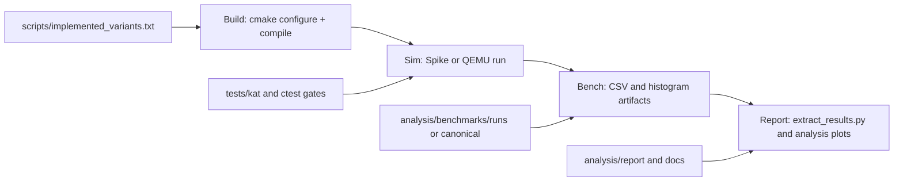

# HQC-RISCV Directory Architecture

## Overview

`hqc-riscv` is a bare-metal RISC-V evaluation framework for HQC (Hamming Quasi-Cyclic), a post-quantum KEM finalist. It benchmarks hardware acceleration strategies using RVV (RISC-V Vector) and carry-less multiply extensions (Zbc/Zvbc) on RISC-V simulators (Spike ISS and QEMU).

The project is structured around descriptive optimization tracks:

| Track | Component | Strategy |
|-------|-----------|----------|
| `baseline_ref` | Polynomial multiply | Vendor Karatsuba (`karatsuba_ref`) |
| `polymul_zbc` | Polynomial multiply | Zbc `clmul/clmulh` base-case Karatsuba (`karatsuba_zbc`) |
| `fafft_zbc` | Polynomial multiply | FAFFT + Zbc butterflies + RVV XOR |
| `hybrid_zbc` | Polynomial multiply | Karatsuba outer + FAFFT inner hybrid |
| `polymul_zvbc` | Polynomial multiply | vector carry-less multiply track (`karatsuba_zvbc`) |
| `keccak_rvv` | Keccak/SHAKE-256 | RVV Keccak-f[1600] 4-way interleaved (`fips202_rvv.c`) |
| `reed_muller_rvv` / `reed_solomon_rvv` | RM/RS decoder | RVV FHT + table-driven syndrome path |

All polynomial multiply variants are compiled in every build, enabling head-to-head comparison. The Keccak and decoder tracks are toggled via CMake flags.

## Execution Pipeline



Pipeline intent:
- Build stage materializes per-level and per-variant ELFs.
- Simulation stage executes KAT or benchmark targets under the selected backend.
- Benchmark stage stores structured CSV/histogram output for reproducible comparisons.
- Report stage turns curated artifacts into tables, plots, and thesis-ready summaries.

---

## File Tree

```
hqc-riscv/
├── CMakeLists.txt
├── compile_commands.json          (symlink → build/qemu/compile_commands.json)
├── README.md
├── bench-test.md
│
├── cmake/
│   ├── hqc_core.cmake
│   └── options.cmake
│
├── toolchain/
│   ├── build-gcc-sysroot.sh
│   ├── build-llvm.sh
│   ├── build-qemu.sh
│   ├── build-spike.sh
│   ├── flags.mk
│   ├── riscv-clang.cmake
│   └── toolchain.env
│
├── include/
│   ├── immintrin.h
│   └── randombytes.h
│
├── src/
│   ├── baseline/                  (reserved — .gitkeep)
│   ├── scalar_zbc/                (reserved — empty)
│   ├── common/
│   │   ├── bench.c
│   │   ├── bench.h
│   │   ├── randombytes.c
│   │   └── rng/
│   │       ├── aes_ctr_drbg.c
│   │       ├── aes_ctr_drbg.h
│   │       ├── tiny_aes.c
│   │       └── tiny_aes.h
│   ├── poly_mul/
│   │   ├── karatsuba_zbc/
│   │   │   └── gf2x_clmul.c       (`polymul_zbc` — implemented)
│   │   ├── fafft_zbc/
│   │   │   ├── fafft.c            (`fafft_zbc` — implemented)
│   │   │   └── fafft_rvv.c        (`fafft_zbc` RVV helper axes)
│   │   ├── hybrid_zbc/
│   │   │   └── hybrid.c           (`hybrid_zbc` — implemented)
│   │   └── fafft_zvbc/
│   │       └── fafft_vclmul.c     (`polymul_zvbc` / `polymul_zvbc_v2` vector work)
│   ├── keccak/
│   │   └── rvv/
│   │       └── fips202_rvv.c      (`keccak_rvv` — planned)
│   └── decode/
│       └── rvv/
│           ├── reed_muller_rvv.c  (`reed_muller_rvv` — planned)
│           └── reed_solomon_rvv.c (`reed_solomon_rvv` — planned)
│
├── sim/
│   ├── common/
│   │   ├── link.ld
│   │   ├── mem.c
│   │   └── startup.S
│   ├── qemu/
│   │   └── run_kat.sh
│   ├── spike/
│   │   ├── parse_commits.py
│   │   ├── run_bench.sh
│   │   ├── run.sh
│   │   └── zvbc_trace.py
│   └── rtl-marian/
│       ├── README.md
│       ├── load_binary.py
│       └── run_verilator.sh
│
├── tests/
│   ├── bench/
│   │   ├── bench_kem.c
│   │   ├── bench_poly_mul.c
│   │   ├── mini_bench.c
│   │   └── mini_bench.mk
│   ├── kat/
│   │   ├── gen_kat_seeds.py
│   │   ├── generated/
│   │   │   ├── kat_seeds_128.h
│   │   │   ├── kat_seeds_192.h
│   │   │   └── kat_seeds_256.h
│   │   ├── kat_check.py
│   │   ├── kat_gen.c
│   │   ├── run_kat.sh
│   │   └── vectors/               (reserved — empty, KAT .rsp files go here)
│   └── unit/                      (reserved — empty, future unit tests)
│
├── scripts/
│   ├── bench/
│   │   ├── run_histogram_all.sh
│   │   ├── run_kat_all.sh
│   │   ├── run_spike_bench_variant.sh
│   │   └── spike_kat.sh
│   ├── ci/
│   │   ├── check_ct.sh
│   │   ├── check_isa_string.sh
│   │   └── check_opcodes.sh
│   ├── debug/
│   │   ├── .gdbinit
│   │   ├── custom_rvv.xml
│   │   ├── hqc_pretty.py
│   │   └── rvv_regs.py
│   └── report/
│       ├── extract_results.py
│       └── gen_report.sh
│
├── analysis/
│   ├── benchmarks/
│   │   ├── amdahl.py
│   │   ├── cycle_counts.csv
│   │   ├── instruction_mix.csv
│   │   ├── plot.py
│   │   ├── baseline_ref/
│   │   │   ├── hqc{128,192,256}_karatsuba_ref_N1.csv
│   │   │   ├── hqc{128,192,256}_karatsuba_ref_polymul_N1.csv
│   │   │   ├── hqc{128,192,256}_karatsuba_ref_polymul.log
│   │   │   ├── hqc{128,192,256}_spike.log
│   │   │   └── pids.txt
│   │   └── polymul_zbc/
│   │       ├── hqc{128,192,256}_karatsuba_ref_polymul_N1.csv
│   │       ├── hqc{128,192,256}_karatsuba_ref_polymul.log
│   │       └── pids.txt
│   ├── ct_verify/
│   │   ├── binsec/                (.gitkeep — future Binsec output)
│   │   ├── ctgrind/               (.gitkeep — future ctgrind output)
│   │   └── dudect/                (.gitkeep — future dudect output)
│   ├── llvm_mca/
│   │   ├── reports/
│   │   │   ├── gf2x_clmul_mca.txt
│   │   │   ├── gf2x_mca.txt
│   │   │   └── gf2x_ref_mca.txt
│   │   │   └── gf2x_ref.s
│   │   └── run_mca.sh
│   └── report/
│       ├── report_2026-04-27.md
│       ├── report_2026-04-29.md
│       ├── table_results_2026-04-27.tex
│       └── table_results_2026-04-29.tex
│
├── docs/
│   ├── GUIDE.md
│   ├── METHODOLOGY.md
│   ├── RUNBOOK.md
│   ├── figures/
│   │   ├── cycle_counts.pdf
│   │   └── instruction_mix.pdf
│   ├── latex/                     (.gitkeep — thesis LaTeX chapters go here)
│   └── literature/                (.gitkeep — bibliography/references go here)
│
├── vendor/
│   └── hqc-ref/                   (git submodule — HQC v5.0.0 reference)
│
├── sysroot/                       (generated — cross-compilation sysroot, gitignored)
│
└── .github/
    └── workflows/
        ├── ct-verify.yml
        ├── kat.yml
        └── opcode-verify.yml
```

---

## Detailed Documentation

---

### Root Files

#### `CMakeLists.txt`
- **Usage**: Main CMake build script. Defines a 3×5 target matrix (3 security levels × 5 polynomial multiply variants) producing up to 45 executables per build directory: 15 KAT targets, 15 BENCH targets (EXCLUDE_FROM_ALL), and 15 POLYMUL_BENCH targets (EXCLUDE_FROM_ALL). Configures simulator backend (`HQC_SIM`), iteration count (`BENCH_N_ITER`), Keccak implementation (`HQC_KECCAK_IMPL`), and decoder implementation (`HQC_DECODE_IMPL`). Includes `cmake/options.cmake` and `cmake/hqc_core.cmake`. Registers CTest KAT gates for CI.
- **Why**: Central orchestrator of the entire build. Without it there is no way to compile any target; it encodes the thesis' head-to-head comparison strategy.
- **Where**: Invoked by every `cmake -B <builddir>` command. Referenced by all CI workflows.

#### `compile_commands.json`
- **Usage**: Symlink created at configure time pointing to `build/compile_commands.json`. Provides per-file compiler invocations for IDE language servers (clangd, Pylance, etc.).
- **Why**: Enables accurate code navigation, diagnostics, and autocompletion without manual IDE setup. The symlink keeps it at the project root where tools expect it.
- **Where**: Consumed by clangd/VS Code. Generated by `set(CMAKE_EXPORT_COMPILE_COMMANDS ON)` in `CMakeLists.txt`.

#### `README.md`
- **Usage**: Project quick-start guide. Covers prerequisites, one-command build/run for QEMU KAT and Spike benchmarking, and pointers to detailed docs.
- **Why**: Entry point for anyone cloning the repository.
- **Where**: Read by contributors and CI maintainers. Referenced by `docs/GUIDE.md`.

---

### `cmake/`

#### `cmake/options.cmake`
- **Usage**: Declares three orthogonal CMake cache variables: `HQC_KECCAK_IMPL` (`ref`|`rvv`), `HQC_DECODE_IMPL` (`ref`|`rvv`), and emits diagnostic STATUS messages indicating the active build phase. Validates values and aborts with FATAL_ERROR on unknown strings.
- **Why**: Decouples the three independently-optimizable HQC components (polynomial multiply, Keccak, decoder) so any combination can be benchmarked without source edits.
- **Where**: Included by `CMakeLists.txt` via `include(cmake/options.cmake)` on every configure. Variables are consumed in the `CMakeLists.txt` target-matrix loop.

#### `cmake/hqc_core.cmake`
- **Usage**: Defines the CMake function `hqc_add_core(LEVEL)`. The function creates a per-security-level OBJECT library (`hqc_core_128`, `hqc_core_192`, `hqc_core_256`) containing the five truly invariant vendor files: `kem.c`, `crypto_memset.c`, `parsing.c`, `vector.c`, `gf.c`. The function is idempotent (returns early if the target already exists).
- **Why**: Compiles invariant code only 3 times (once per security level) instead of 15 times (once per level × polymul). Keeps compilation clean: no variant-specific preprocessor symbols leak into invariant code.
- **Where**: Included by `CMakeLists.txt`. `hqc_add_core(${LEVEL})` is called inside the level loop; each resulting OBJECT library is linked via `$<TARGET_OBJECTS:hqc_core_${LEVEL}>` into every executable.

---

### `toolchain/`

#### `toolchain/build-llvm.sh`
- **Usage**: Shell script that clones and builds LLVM/Clang 21.1.1 from source into `~/Thesis/installed-tools/`, including the RISC-V target backend and LLD linker.
- **Why**: The project requires a specific Clang version with `-menable-experimental-extensions` support for Zvbc. System-provided LLVM is unlikely to match this version or include the experimental RISC-V extensions.
- **Where**: Run once during initial environment setup: `bash toolchain/build-llvm.sh`. The resulting toolchain is then used by all CMake and Make builds.

#### `toolchain/build-gcc-sysroot.sh`
- **Usage**: Builds a minimal GCC cross-compilation sysroot for `riscv64-unknown-elf` into `hqc-riscv/sysroot/`. Provides the runtime builtins (`libgcc`) needed by Clang for LTO linking.
- **Why**: Clang's LTO linker (`lld`) requires GCC-compatible builtins for operations like 128-bit integer division that are not inlined. The sysroot is separate from the compiler itself.
- **Where**: Run once after `build-llvm.sh`: `bash toolchain/build-gcc-sysroot.sh`. Result referenced via `--sysroot` in `toolchain/riscv-clang.cmake`.

#### `toolchain/build-qemu.sh`
- **Usage**: Builds QEMU 10.2.2 from source with the `riscv64-softmmu` target into `~/Thesis/installed-tools/`.
- **Why**: QEMU provides fast functional simulation (~10–68s per KAT run) for correctness testing. A specific QEMU version is required to match the `virt` machine configuration used in `sim/qemu/run_kat.sh`.
- **Where**: Run once during setup: `bash toolchain/build-qemu.sh`. The resulting `qemu-system-riscv64` binary is called by `sim/qemu/run_kat.sh` and CI workflows.

#### `toolchain/build-spike.sh`
- **Usage**: Builds the Spike RISC-V ISS (latest `master`) from source into `~/Thesis/installed-tools/`, including Zvbc extension support.
- **Why**: Spike is the authoritative instruction-count simulator (CPI=1 in-order model). The Zvbc extension (`vclmul.vv`) is only available in recent Spike builds; the system-provided Spike typically lacks it.
- **Where**: Run once during setup: `bash toolchain/build-spike.sh`. The resulting `spike` binary is called by `sim/spike/run_bench.sh`, `run.sh`, and CI's `kat-spike-zvbc` job.

#### `toolchain/riscv-clang.cmake`
- **Usage**: CMake toolchain file for cross-compilation. Sets `CMAKE_C_COMPILER` and `CMAKE_ASM_COMPILER` to Clang/LLVM from `~/Thesis/installed-tools/`. Configures ISA `rv64gcv_zbc_zbb_zbkb_zvbc_zicntr_zihpm`, ABI `lp64d`, optimization flags (`-O3 -flto -ffreestanding -fno-tree-vectorize`), and linker flags (`-fuse-ld=lld --gc-sections -nostartfiles -nostdlib`).
- **Why**: Bare-metal RISC-V cross-compilation requires a sysroot-free toolchain with explicit ISA flags. Clang is chosen over GCC for better `-menable-experimental-extensions` support (Zvbc). The `-fno-tree-vectorize` flag ensures all SIMD is hand-written, not auto-generated.
- **Where**: Passed to CMake via `cmake -DCMAKE_TOOLCHAIN_FILE=toolchain/riscv-clang.cmake`. Used by all CMake build directories.

#### `toolchain/flags.mk`
- **Usage**: Shared compiler/linker flag definitions for GNU Make-based builds. Defines `CC`, `CLANG`, `MARCH`, `MABI`, `CFLAGS`, `CLANGFLAGS`, `LDFLAGS`, and `ASFLAGS`. Included by sub-Makefiles via `include $(ROOT)/toolchain/flags.mk`.
- **Why**: Centralizes flag definitions for Makefile-based targets (`tests/bench/mini_bench.mk`) so they stay consistent with the CMake builds.
- **Where**: Included by `tests/bench/mini_bench.mk`.

#### `toolchain/toolchain.env`
- **Usage**: Shell environment setup script. Sets `RISCV`, `PATH`, `CC`, `CXX`, and `AR` to point at the locally installed toolchain under `~/Thesis/installed-tools/`.
- **Why**: Provides a one-command way to configure the shell for manual compilation and script execution without relying on system-installed RISC-V tools.
- **Where**: Sourced manually: `source toolchain/toolchain.env`. Used implicitly by CI workflows that install the toolchain to the same path.

---

### `include/`

#### `include/immintrin.h`
- **Usage**: Empty stub header that satisfies `#include <immintrin.h>` on non-x86 targets.
- **Why**: The HQC reference implementation conditionally includes `<immintrin.h>` (an x86-only header). On RISC-V this include would fail with "only meant for x86/x64". Since no x86 SIMD types are actually used, an empty stub silences the error without touching upstream vendor code.
- **Where**: Picked up via the global include path `-I${CMAKE_SOURCE_DIR}/include` configured in `CMakeLists.txt`. Shadows the real `immintrin.h` for all targets.

#### `include/randombytes.h`
- **Usage**: Mode-independent public API for random byte generation. Declares `randombytes_init()` and `randombytes()` with a single interface regardless of compile-time mode.
- **Why**: HQC uses `randombytes()` throughout for key generation. Two modes are needed without changing call sites: KAT mode (deterministic AES-CTR DRBG for NIST vector reproduction) and Bench mode (fast fixed-pattern fill to avoid AES overhead in cycle counts). The header is the shared contract.
- **Where**: Included by `src/common/randombytes.c`, `tests/kat/kat_gen.c`, and vendor sources that call `randombytes()`.

---

### `src/`

#### `src/baseline/`
- **Usage**: Reserved directory (`.gitkeep` only). Intended for future baseline comparison sources that do not fit the existing polymul variant structure.
- **Why**: Placeholder to establish directory structure before content is added; avoids later directory renames that would break `git log` history.
- **Where**: Not referenced in the build system yet.

#### `src/scalar_zbc/`
- **Usage**: Reserved empty directory. Intended for standalone scalar Zbc utility routines (e.g., GF(2^128) multiply used in `tests/bench/mini_bench.c`).
- **Why**: Separates isolated scalar Zbc helpers from the full polymul implementations under `src/poly_mul/`.
- **Where**: Not referenced in the build system yet.

#### `src/common/bench.c` / `src/common/bench.h`
- **Usage**: Bare-metal cycle counter and console I/O. Implements `hqc_rdcycle()` (reads `mcycle` CSR), `hqc_htif_puts()`, `hqc_htif_putu64()`, and `hqc_htif_exit()`. Supports two output backends: Spike HTIF (`tohost`) and QEMU UART, selected by the `HQC_SIM_QEMU=1` compile-time flag.
- **Why**: There is no OS or libc on the bare-metal target. All console output and cycle measurement must go through custom RISC-V CSR reads and simulator-specific exit mechanisms. This file is the only I/O layer.
- **Where**: Compiled into every KAT, BENCH, and POLYMUL_BENCH target via `LOCAL_COMMON_SOURCES` / `LOCAL_BENCH_SOURCES` in `CMakeLists.txt`. Used directly by `tests/kat/kat_gen.c`, `tests/bench/bench_kem.c`, `tests/bench/bench_poly_mul.c`, `tests/bench/mini_bench.c`.

#### `src/common/randombytes.c`
- **Usage**: Mode-switch wrapper for `randombytes()`. When `HQC_KAT_MODE=1`, delegates to `aes_ctr_drbg.c` for bit-identical NIST vector output. When `HQC_BENCH_MODE=1`, fills with a fixed pattern (no AES overhead).
- **Why**: KAT correctness requires NIST-compatible deterministic output; benchmark accuracy requires that AES-CTR DRBG latency does not appear in `rdcycle` measurements. A single source file with compile-time switching avoids two separate copies of every call site.
- **Where**: Compiled into all targets via `LOCAL_COMMON_SOURCES` / `LOCAL_BENCH_SOURCES`. Implements the `randombytes` symbol required by `vendor/hqc-ref/src/common/symmetric.c` and other vendor files.

#### `src/common/rng/aes_ctr_drbg.c` / `aes_ctr_drbg.h`
- **Usage**: NIST SP 800-90A AES-256 CTR_DRBG. Provides `randombytes_init(seed[48])` and `randombytes(out, len)` producing bit-identical output to the NIST KAT reference `rng.c`.
- **Why**: The KAT verification workflow compares bare-metal output against NIST `.rsp` files. Diverging even one byte from the NIST reference RNG would produce different ciphertext and cause false failures.
- **Where**: Included by `src/common/randombytes.c`. Compiled into KAT targets only (excluded from BENCH targets to keep cycle counts clean).

#### `src/common/rng/tiny_aes.c` / `tiny_aes.h`
- **Usage**: Compact public-domain AES-256 ECB implementation (TinyAES by kokke). Provides `aes256_key_expansion()` and `aes256_ecb_encrypt()`.
- **Why**: The AES-CTR DRBG (`aes_ctr_drbg.c`) requires an AES-256 ECB primitive. Using the full OpenSSL or a hardware-accelerated AES would introduce unnecessary dependencies on a bare-metal target with no OS. TinyAES is small, self-contained, and sufficient for KAT-only use (not security-critical at run time).
- **Where**: Included and called by `src/common/rng/aes_ctr_drbg.c`.

---

### `src/poly_mul/` — Polynomial Multiply Variants

All five variants implement the same interface: `void vect_mul(uint64_t *o, const uint64_t *a, const uint64_t *b)` declared in `vendor/hqc-ref/src/ref/gf2x.h`. Exactly one variant is linked into each executable target.

#### `src/poly_mul/karatsuba_zbc/gf2x_clmul.c` *(`polymul_zbc` — implemented)*
- **Usage**: Replaces the vendor Karatsuba `gf2x.c` with a Zbc carry-less multiply (`clmul`/`clmulh`) base case. Uses `clmul`/`clmulh` to compute a 128-bit product in 2 instructions instead of the 64-bit schoolbook loop, then applies lazy Barrett reduction and a depth sweep to find the optimal Karatsuba recursion depth.
- **Why**: `clmul` eliminates the inner-loop data-dependent branches in polynomial multiplication, directly reducing the dominant cost of the HQC KEM (>90% of runtime).
- **Where**: Selected by `POLYMUL=karatsuba_zbc` in `CMakeLists.txt`. Compiled into `hqc{128,192,256}_karatsuba_zbc.elf` and corresponding bench/polymul-bench targets.

#### `src/poly_mul/fafft_zbc/fafft.c` *(`fafft_zbc` — implemented)*
- **Usage**: Frobenius Additive FFT (FAFFT) polynomial multiplication for GF(2)[x]. Implements the Cantor basis conversion, CRT decomposition, and Zbc `clmul`/`clmulh` butterfly multiplications with Barrett reduction. Precomputed 256-byte lookup tables handle small-field (m ≤ 8) arithmetic.
- **Why**: FAFFT achieves O(n log²n) complexity vs Karatsuba's O(n^1.585). For HQC's large field sizes (n ≈ 17669–57637), this asymptotic advantage was the main `fafft_zbc` hypothesis that the benchmarks then tested against `polymul_zbc`.
- **Where**: Selected by `POLYMUL=fafft_zbc`. Always compiled together with `fafft_rvv.c`.

#### `src/poly_mul/fafft_zbc/fafft_rvv.c` *(`fafft_zbc` RVV helper axes)*
- **Usage**: RVV-vectorized helper routines for FAFFT. Implements three vectorization axes: bulk XOR combine (`vxor.vv` LMUL=4), tower-field table lookup (`vluxei8.v` for 32 simultaneous GF(2^8) multiplications), and butterfly-order memory permutation (`vrgatherei16.v`). Key exported function: `hqc_vxor_words()`.
- **Why**: The FAFFT XOR-combine phase is the widest bottleneck (purely data-parallel). RVV's `vxor.vv` with LMUL=4 processes 256 bytes per instruction, providing throughput independent of scalar loop overhead.
- **Where**: Compiled alongside `fafft.c` for the `fafft_zbc` variant. Requires `-march=rv64gcv_zbc` (RVV present, but Zvbc not needed here).

#### `src/poly_mul/hybrid_zbc/hybrid.c` *(`hybrid_zbc` — implemented)*
- **Usage**: Hybrid Karatsuba-FAFFT polynomial multiplier. Applies 1–2 outer Karatsuba levels to reduce the problem to 3–9 sub-multiplications of smaller polynomials, then delegates each sub-multiplication to the FAFFT implementation. This eliminates FAFFT's padding waste (HQC-1 pads 17669 → 32768).
- **Why**: Pure FAFFT wastes ~46% of work on zero padding; pure Karatsuba is suboptimal at large sizes. The hybrid combines Karatsuba's tight fit to problem size with FAFFT's algorithmic efficiency.
- **Where**: Selected by `POLYMUL=hybrid_zbc`. Internally calls `fafft_zbc`'s `vect_mul` after the `fafft_zbc` benchmark set establishes its performance.

#### `src/poly_mul/fafft_zvbc/fafft_vclmul.c` *(`polymul_zvbc` upper-bound vector work)*
- **Usage**: FAFFT using `vclmul.vv`/`vclmulh.vv` (Zvbc vector carry-less multiply) for vectorized butterfly multiplications. Processes VLEN/64 butterfly multiplications per instruction (4 per instruction at VLEN=256). Gated by `HQC_POLYMUL_ZVBC=1`.
- **Why**: Zvbc is ratified but not yet in production silicon. This variant quantifies the incentive for processor vendors to ship Zvbc support for post-quantum workloads, which is a key thesis claim. Can only be run on Spike with `--isa=rv64gcv_zvbc`.
- **Where**: Selected by `POLYMUL=fafft_zvbc`. The CI job `kat-spike-zvbc` in `.github/workflows/kat.yml` runs this variant exclusively on Spike.

---

### `src/keccak/rvv/`

#### `src/keccak/rvv/fips202_rvv.c` *(`keccak_rvv` — planned)*
- **Usage**: RVV-vectorized Keccak-f[1600] and HQC-specific SHAKE-256 wrappers. Based on Zhang et al. (ePrint 2023) with 4-way multi-instance interleaving for `seed_expand()` (the PRF for sparse vector generation). Exports `shake256()` (standard FIPS 202 signature) and `shake256_4way()`.
- **Why**: `seed_expand()` calls SHAKE-256 at least 2×(N/8) times per KEM operation. RVV interleaving processes 4 independent Keccak instances simultaneously, amortizing the θ/ρ/π/χ/ι step overhead across instances. This is the `keccak_rvv` speedup target.
- **Where**: Selected when `HQC_KECCAK_IMPL=rvv` in CMake. Replaces `vendor/hqc-ref/lib/fips202/fips202.c` at link time.

---

### `src/decode/rvv/`

#### `src/decode/rvv/reed_muller_rvv.c` *(`reed_muller_rvv` — planned)*
- **Usage**: RVV-vectorized 128-point Fast Hadamard Transform (FHT) for Reed-Muller decoding. Implements the 7-stage butterfly structure using `vadd.vv`/`vsub.vv` with LMUL=4 (32 butterfly pairs per iteration). Replaces `vendor/hqc-ref/src/ref/reed_muller.c` when `HQC_DECODE_IMPL=rvv`.
- **Why**: The RM decoder's FHT is a perfectly regular 7-stage butterfly, ideal for RVV with large LMUL. All 128 butterflies in the innermost stage are independent and data-parallel.
- **Where**: Selected when `HQC_DECODE_IMPL=rvv`. Called from `vendor/hqc-ref/src/common/code.c` via the `reed_muller_decode()` symbol.

#### `src/decode/rvv/reed_solomon_rvv.c` *(`reed_solomon_rvv` — planned)*
- **Usage**: RVV-accelerated Reed-Solomon decoder. Vectorizes the syndrome computation stage (`vluxei8.v` for 32 simultaneous GF(2^8) multiplications) and the Chien search stage (256 independent polynomial evaluations). The Berlekamp-Massey step remains scalar (sequential data dependency).
- **Why**: RS syndrome computation and Chien search are the most expensive parts of RS decoding, and both have data-parallel structure. GF(2^8) CLMUL via `vluxei8.v` vectorizes the field multiplications without Zvbc.
- **Where**: Selected when `HQC_DECODE_IMPL=rvv`. Called from `vendor/hqc-ref/src/common/code.c` via the `reed_solomon_decode()` symbol.

---

### `sim/`

#### `sim/common/link.ld`
- **Usage**: GNU ld linker script. Defines the memory map for bare-metal RISC-V:
  - `DRAM`: base `0x80000000`, 128 MB
  - Sections in order: `.text.startup` (CRT0), `.text`, `.rodata`, `.tohost` (64-byte aligned for Spike HTIF), `.data`, `.bss`, `.stack` (512 KB at top of DRAM)
- **Why**: Without an OS or proxy kernel, the linker must explicitly place all sections at the correct physical addresses expected by Spike/QEMU. The `.tohost` section alignment is required for HTIF communication with Spike.
- **Where**: Referenced via `LINK_DEPENDS` on every executable target in `CMakeLists.txt` and via `LDFLAGS` in `toolchain/flags.mk`.

#### `sim/common/startup.S`
- **Usage**: Bare-metal CRT0 (C Runtime 0) in RISC-V assembly. Boot sequence: (1) set `sp = _stack_top`, (2) set `mstatus.VS = Dirty` (bits [10:9] = 0b11) to enable the V extension without trapping, (3) execute `vsetvli` to initialize vector type (e64, m1, tail-agnostic, mask-agnostic), (4) zero the BSS segment, (5) call `main(0, NULL)`, (6) exit via HTIF `tohost`.
- **Why**: Every RISC-V bare-metal binary needs a startup sequence before `main()` can run. Setting `mstatus.VS` is critical: without it, any vector instruction traps with an illegal instruction exception.
- **Where**: Compiled into every executable target as the first source file (`${STARTUP_S}`) in `CMakeLists.txt`.

#### `sim/common/mem.c`
- **Usage**: Minimal bare-metal C runtime — provides `memcpy`, `memmove`, `memset`, `memcmp`, `strlen` for targets compiled with `-nostdlib`.
- **Why**: `-nostdlib` excludes libc. The vendor HQC code and test harnesses depend on these standard memory functions. Compiled with full ISA flags so the auto-vectorizer can substitute RVV sequences at -O3 if it deems them optimal.
- **Where**: Compiled into every target via `LOCAL_COMMON_SOURCES` / `LOCAL_BENCH_SOURCES` in `CMakeLists.txt`.

#### `sim/qemu/run_kat.sh`
- **Usage**: Shell script that runs a KAT ELF under `qemu-system-riscv64` with the `virt` machine, captures serial output, and returns the QEMU exit code.
- **Why**: QEMU provides fast (~10–68s) functional correctness checking for all scalar polymul variants. Used by the CMake CTest KAT gate and CI.
- **Where**: Called by `add_test(... COMMAND ${CMAKE_SOURCE_DIR}/tests/kat/run_kat.sh ...)` in `CMakeLists.txt`, by `scripts/bench/run_kat_all.sh`, and directly by `.github/workflows/kat.yml`.

#### `sim/spike/run.sh`
- **Usage**: Runs an ELF on Spike with full instruction logging (`--log-commits`). Produces a trace file for profiling with `sim/spike/parse_commits.py`.
- **Why**: Spike's `--log-commits` provides the exact retired instruction sequence needed for instruction-mix analysis. This mode is intentionally slow (used only for profiling, not timing).
- **Where**: Called manually or by `scripts/bench/run_histogram_all.sh` when instruction-level profiling is needed.

#### `sim/spike/run_bench.sh`
- **Usage**: Runs an ELF on Spike with no logging flags. Records wall-clock time and captures the CSV output (cycle counts from `rdcycle`) emitted by the benchmark harness.
- **Why**: Spike without logging is the primary timing environment. `rdcycle` on Spike counts retired instructions (CPI=1 for in-order model), giving a reproducible, hardware-agnostic performance metric. QEMU's `rdcycle` is a software counter and unreliable for timing.
- **Where**: Called by `scripts/bench/run_spike_bench_variant.sh` and manually for ad-hoc benchmarking.

#### `sim/spike/parse_commits.py`
- **Usage**: Parses Spike `--log-commits` trace output. Extracts instruction opcode frequencies, identifies hot loops, and generates instruction-mix histograms.
- **Why**: Raw Spike commit logs are megabytes of per-instruction lines. This script aggregates them into opcode counts for the thesis instruction-mix analysis.
- **Where**: Called after `sim/spike/run.sh` produces a trace. Output fed into `analysis/benchmarks/instruction_mix.csv`.

#### `sim/spike/zvbc_trace.py`
- **Usage**: Zvbc-specific instruction profiler. Filters Spike commit logs for `vclmul.vv`/`vclmulh.vv` instructions, counts their frequency relative to total instruction count, and reports utilization.
- **Why**: Provides direct evidence for the Zvbc speedup claim: how many vector carry-less multiply instructions execute per KEM operation, and what fraction of runtime they represent.
- **Where**: Called after running the `fafft_zvbc` variant on Spike with `--log-commits`.

#### `sim/rtl-marian/README.md`
- **Usage**: Setup guide for running HQC binaries on the PULP Ara / Marian open-source RISC-V vector processor RTL via Verilator or QuestaSim.
- **Why**: RTL simulation is the third tier of the evaluation framework (after Spike ISS and QEMU DBT). It provides cycle-accurate results for the Zvbc upper-bound estimates, including pipeline effects not visible in Spike's in-order model.
- **Where**: Read by developers setting up the RTL co-simulation environment. References `sim/rtl-marian/load_binary.py` and `run_verilator.sh`.

---

### `tests/`

#### `tests/kat/kat_gen.c`
- **Usage**: Bare-metal KAT runner. For each of 100 pre-seeded vectors from `tests/kat/generated/kat_seeds_<LEVEL>.h`: initializes the AES-CTR DRBG, calls `crypto_kem_keypair` / `crypto_kem_enc` / `crypto_kem_dec`, verifies `ss_enc == ss_dec`, and emits the shared secret as hex for external diffing against NIST `.rsp` files. Compiled with `HQC_KAT_MODE=1`.
- **Why**: NIST KAT compliance is a hard requirement for any PQC candidate implementation. This is the correctness gate that must pass before any phase is declared complete.
- **Where**: Compiled into all 15 KAT targets (one per level × polymul) in `CMakeLists.txt`. Its output is consumed by `tests/kat/run_kat.sh` and `tests/kat/kat_check.py`.

#### `tests/kat/run_kat.sh`
- **Usage**: Orchestrates a single KAT: runs the ELF under QEMU (or Spike for `fafft_zvbc`), captures output, and diffs it against the expected shared secrets from `tests/kat/kat_check.py`.
- **Why**: Provides the CTest command registered by `add_test()` in `CMakeLists.txt` and the CI execution primitive.
- **Where**: Called by CTest (`ctest`), by `.github/workflows/kat.yml`, and by `scripts/bench/run_kat_all.sh`.

#### `tests/kat/kat_check.py`
- **Usage**: Python script that verifies bare-metal KAT output against the NIST `.rsp` reference files. Parses the hex shared-secret lines emitted by `kat_gen.c` and compares them against `vendor/hqc-ref/KAT/hqc-{1,3,5}/PQCkemKAT_*.rsp`.
- **Why**: Provides a scriptable pass/fail verdict for the full 100-vector KAT suite, enabling automated CI checks.
- **Where**: Called by `tests/kat/run_kat.sh` after QEMU/Spike execution.

#### `tests/kat/gen_kat_seeds.py`
- **Usage**: One-time generation script. Reads NIST `.rsp` files from `vendor/hqc-ref/KAT/` and generates the C header files `tests/kat/generated/kat_seeds_<LEVEL>.h` containing the 100 entropy seeds and expected shared secrets for each security level.
- **Why**: Embedding seeds as compile-time C arrays avoids filesystem access from bare-metal code (which has no OS). The headers are committed so CI does not need to re-run this script.
- **Where**: Run once manually: `python3 tests/kat/gen_kat_seeds.py`. Output committed to `tests/kat/generated/`.

#### `tests/kat/generated/kat_seeds_128.h`, `kat_seeds_192.h`, `kat_seeds_256.h`
- **Usage**: Auto-generated C headers. Each provides `kat_seeds[100][48]` (entropy seeds) and `kat_ss[100][32]` (expected shared secrets) for the corresponding security level.
- **Why**: The bare-metal KAT runner (`kat_gen.c`) needs deterministic seeds at compile time; there is no filesystem to read `.rsp` files from at runtime.
- **Where**: Included by `tests/kat/kat_gen.c` via `#include "generated/kat_seeds_<LEVEL>.h"`. The level is selected at compile time by the `SECURITY_LEVEL` preprocessor definition.

#### `tests/kat/vectors/`
- **Usage**: Reserved empty directory. Intended to hold KAT `.rsp` vector files if they are downloaded locally (they are gitignored per `.gitignore`).
- **Why**: Keeps a well-known location for locally-cached KAT vectors without committing large binary files to the repository.
- **Where**: Not referenced in the build system; populated manually if needed.

#### `tests/bench/bench_kem.c`
- **Usage**: Full-KEM cycle-count benchmark. Runs `N_ITER` iterations of `crypto_kem_keypair`, `crypto_kem_enc`, and `crypto_kem_dec`, measures `rdcycle` before and after each, and emits min/median/max CSV output. Compiled with `HQC_BENCH_MODE=1`.
- **Why**: Full-KEM instruction counts are the primary thesis metric. Running all three operations measures the realistic deployment cost.
- **Where**: Compiled into all 15 BENCH targets (`bench_hqc{128,192,256}_{variant}.elf`) in `CMakeLists.txt`. Run via `sim/spike/run_bench.sh`.

#### `tests/bench/bench_poly_mul.c`
- **Usage**: `vect_mul()`-only micro-benchmark. Benchmarks the polynomial multiply function in isolation (no keypair/encaps/decaps, no Keccak). Emits CSV with min/median/max cycle counts. Compiled with `HQC_BENCH_MODE=1` and `N_ITER=1` for Spike.
- **Why**: `vect_mul()` accounts for >90% of total KEM runtime. Isolating it provides a faster optimization loop than full KEM runs while preserving the key hotspot signal.
- **Where**: Compiled into all 15 POLYMUL_BENCH targets (`bench_polymul_hqc{128,192,256}_{variant}.elf`). Run via `scripts/bench/run_spike_bench_variant.sh`.

#### `tests/bench/mini_bench.c`
- **Usage**: Minimal standalone benchmark for three HQC-relevant micro-kernels: (1) scalar GF(2^128) multiply via `clmul`/`clmulh`, (2) RVV-accelerated 256-byte XOR (`vxor.vv` e64/m4), (3) scalar XOR-rotate control baseline. Emits one CSV line per kernel.
- **Why**: Used to validate that Spike and QEMU agree on instruction counts for simple kernels, and to confirm `clmul`/RVV instructions are being compiled and executed correctly before running the full polymul suite.
- **Where**: Built via `tests/bench/mini_bench.mk`. Referenced in `bench-test.md` as the diagnostic used to isolate the Spike `_zicntr` bug.

#### `tests/bench/mini_bench.mk`
- **Usage**: Standalone GNU Makefile for building `mini_bench.c` without CMake. Includes `toolchain/flags.mk` for consistent flags. Selects Spike or QEMU backend via `SIM=[spike|qemu]`.
- **Why**: Provides a fast, CMake-independent build path for the mini-benchmark, useful when debugging toolchain or ISA issues before the full CMake configure is working.
- **Where**: Invoked with `make -f tests/bench/mini_bench.mk SIM=spike`.

#### `tests/unit/`
- **Usage**: Reserved empty directory. Will contain unit tests for GF(2^m) arithmetic, polynomial multiplication correctness, and Reed-Muller/Solomon decoding once `fafft_zbc` and the decoder tracks are complete.
- **Why**: Unit tests at the algorithm level (not just KAT) allow faster feedback during development of individual math components without running the full 100-vector KAT suite.
- **Where**: Not referenced in the build system yet.

---

### `scripts/`

#### `scripts/bench/run_kat_all.sh`
- **Usage**: Iterates over all 15 KAT targets and runs each via `tests/kat/run_kat.sh` on QEMU, collecting pass/fail results.
- **Why**: Allows a single command to verify correctness of the entire 3×5 target matrix before committing results.
- **Where**: Run manually before declaring a phase complete. Also used as a pre-merge check.

#### `scripts/bench/run_spike_bench_variant.sh`
- **Usage**: Runs all polymul micro-benchmarks for a given phase on Spike in background processes, logging PIDs to `analysis/benchmarks/phase<N>/pids.txt`.
- **Why**: Spike benchmark duration is host- and variant-dependent. Launching jobs in background and tracking PIDs supports asynchronous execution without blocking the terminal.
- **Where**: Called once per phase: `./scripts/bench/run_spike_bench_variant.sh polymul_zbc`.

#### `scripts/bench/run_histogram_all.sh`
- **Usage**: Runs all targets on Spike with `--log-commits` to collect instruction histograms, then calls `sim/spike/parse_commits.py` to aggregate opcode frequency data.
- **Why**: Instruction mix analysis (which opcodes dominate) is a secondary metric that complements raw cycle counts. Required for the thesis methodology section.
- **Where**: Called when preparing the instruction-mix CSV for `analysis/benchmarks/instruction_mix.csv`.

#### `scripts/bench/spike_kat.sh`
- **Usage**: Runs the `fafft_zvbc` KAT targets on Spike with the extended ISA string `--isa=rv64gcv_zbc_zbb_zbkb_zvbc`, which is required at Spike runtime for Zvbc instructions.
- **Why**: `fafft_zvbc` uses `vclmul.vv` instructions that Spike only recognizes with the explicit `--isa` flag including `zvbc`. Standard QEMU KAT scripts do not pass this flag.
- **Where**: Called by `.github/workflows/kat.yml` in the `kat-spike-zvbc` CI job.

#### `scripts/ci/check_opcodes.sh`
- **Usage**: Disassembles `hqc128_fafft_zvbc.elf` and verifies that `vclmul` and `clmul` opcode mnemonics are present in the output. Exits non-zero if not found.
- **Why**: Ensures the compiler actually emitted the target ISA extensions rather than silently falling back to scalar code. Guards against `-menable-experimental-extensions` regression.
- **Where**: Called by the `verify_vclmul` CMake custom target and by `.github/workflows/opcode-verify.yml`.

#### `scripts/ci/check_isa_string.sh`
- **Usage**: Reads the ELF NOTES section of a binary and verifies that the ISA attribute string includes the expected extensions (e.g., `zbc`, `zvbc`, `zicntr`).
- **Why**: An ELF with the wrong ISA string can pass compilation but trap at runtime on Spike when it encounters an unrecognized instruction. This check catches ISA string mismatches before running tests.
- **Where**: Called by `.github/workflows/opcode-verify.yml`.

#### `scripts/ci/check_ct.sh`
- **Usage**: Runs constant-time verification tools (Binsec or ctgrind) against the KEM implementation and exits non-zero if secret-dependent branches or memory accesses are detected.
- **Why**: Constant-time behavior is a security requirement for any KEM implementation. Automated CI enforcement prevents regression.
- **Where**: Called by `.github/workflows/ct-verify.yml`.

#### `scripts/debug/.gdbinit`

> **Note**: The `.gdbinit` file resides inside `scripts/debug/` but is loaded by GDB when launched from the project root or via `set auto-load safe-path`.

- **Usage**: GDB initialization script for debugging on Spike/QEMU. Sets the remote target, loads `scripts/debug/custom_rvv.xml` for V-extension register descriptions, and configures pretty-printers.
- **Why**: Debugging bare-metal RISC-V via GDB remote requires explicit connection setup. The V-extension registers are not in standard GDB descriptions and need the custom XML.
- **Where**: Loaded automatically by GDB from `scripts/debug/` when the `auto-load` path is configured, or sourced manually: `gdb -x scripts/debug/.gdbinit`.

#### `scripts/debug/custom_rvv.xml`
- **Usage**: GDB target description XML file for RISC-V V-extension registers. Describes the 32 vector registers (v0–v31) and vector CSRs (`vl`, `vtype`, `vcsr`).
- **Why**: GDB's built-in RISC-V description does not include V-extension registers. Without this file, `info registers` does not show vector state, making it impossible to debug RVV code.
- **Where**: Loaded by GDB via `scripts/debug/.gdbinit` using `set tdesc filename`.

#### `scripts/debug/hqc_pretty.py`
- **Usage**: GDB Python pretty-printer for HQC-specific types (polynomial arrays, ciphertext structs). Formats raw byte arrays as hex or binary polynomials.
- **Why**: HQC polynomials are 64-bit word arrays of up to ~900 words. The default GDB array display is unusable for debugging polynomial arithmetic.
- **Where**: Auto-loaded by GDB via `scripts/debug/.gdbinit` using `source hqc_pretty.py`.

#### `scripts/debug/rvv_regs.py`
- **Usage**: GDB Python helper script that reads and displays all active vector registers in a human-readable format (decoded by element type and LMUL setting from `vtype`).
- **Why**: The raw `v0`–`v31` register values are uninterpretable without knowing the active `vtype`. This script combines `vtype` decoding with register display.
- **Where**: Sourced in GDB via `scripts/debug/.gdbinit` or manually: `(gdb) source scripts/debug/rvv_regs.py`.

#### `scripts/report/gen_report.sh`
- **Usage**: Master report generation script. Collects all CSV files from `analysis/benchmarks/`, calls `scripts/report/extract_results.py`, and produces both a Markdown summary and a LaTeX results table.
- **Why**: Automates the final step of the thesis workflow: from raw benchmark data to thesis-ready tables, avoiding manual transcription errors.
- **Where**: Run manually after benchmarks complete: `./scripts/report/gen_report.sh`. Output stored in `analysis/report/`.

#### `scripts/report/extract_results.py`
- **Usage**: Parses benchmark CSV files, computes speedup ratios relative to the `karatsuba_ref` baseline, and generates formatted Markdown and LaTeX tables.
- **Why**: The thesis needs reproducible, automatically-generated tables that stay in sync with updated benchmark data. Manual table editing is error-prone and slow.
- **Where**: Called by `scripts/report/gen_report.sh`.

---

### `analysis/`

#### `analysis/benchmarks/cycle_counts.csv`
- **Usage**: Aggregated cycle-count results across all measured phases and security levels, consolidated from per-phase CSV files.
- **Why**: Single source of truth for the thesis performance table. Consumed by `analysis/benchmarks/plot.py`.
- **Where**: Written by `scripts/report/extract_results.py`. Read by `analysis/benchmarks/plot.py` and `analysis/benchmarks/amdahl.py`.

#### `analysis/benchmarks/instruction_mix.csv`
- **Usage**: Opcode frequency breakdown across measured phases. Contains counts of categories like `clmul`, `vxor.vv`, `load`, `store`, etc.
- **Why**: Instruction mix is required for the thesis methodology to justify using instruction count (not wall-clock time) as the primary metric. Shows which operations dominate.
- **Where**: Written by `sim/spike/parse_commits.py` via `scripts/bench/run_histogram_all.sh`.

#### `analysis/benchmarks/amdahl.py`
- **Usage**: Computes Amdahl's Law speedup projections. Takes the fraction of runtime spent in each HQC component (polymul, Keccak, decoder) and models the maximum speedup achievable by optimizing each phase independently and together.
- **Why**: Guides prioritization: if `keccak_rvv` only accounts for a small runtime share after polymul acceleration, the decoder tracks have limited impact. Amdahl analysis is part of the thesis motivation.
- **Where**: Run manually: `python3 analysis/benchmarks/amdahl.py`. Inputs from `cycle_counts.csv`.

#### `analysis/benchmarks/plot.py`
- **Usage**: Generates bar charts and line plots of cycle counts and instruction mix from the CSV files. Outputs PDFs to `docs/figures/`.
- **Why**: Visual presentation of performance results for the thesis document.
- **Where**: Run manually: `python3 analysis/benchmarks/plot.py`. Outputs `docs/figures/cycle_counts.pdf` and `docs/figures/instruction_mix.pdf`.

#### `analysis/benchmarks/baseline_ref/` and `analysis/benchmarks/polymul_zbc/`
- **Usage**: Per-phase benchmark data directories. Each contains: `hqc{128,192,256}_karatsuba_ref_N1.csv` (full KEM cycle counts), `hqc{128,192,256}_karatsuba_ref_polymul_N1.csv` (polymul micro-bench counts), `*.log` (Spike output logs), and `pids.txt` (background job PID log).
- **Why**: Preserves raw benchmark data for reproducibility and for comparing across phases. The `pids.txt` files track which background Spike processes were launched, allowing them to be waited on or killed.
- **Where**: Written by `scripts/bench/run_spike_bench_variant.sh`. Read by `scripts/report/extract_results.py`.

#### `analysis/ct_verify/binsec/`, `ctgrind/`, `dudect/`
- **Usage**: Reserved directories (`.gitkeep` only) for constant-time verification tool outputs.
  - `binsec/`: Binary code analysis results from the Binsec tool.
  - `ctgrind/`: Valgrind-based ct-grind output (taint tracking).
  - `dudect/`: DUDect statistical timing test results.
- **Why**: Provides a well-organized place for CT verification artifacts that will be generated by `.github/workflows/ct-verify.yml` and `scripts/ci/check_ct.sh`.
- **Where**: Written by CI when the `ct-verify` workflow runs.

#### `analysis/llvm_mca/run_mca.sh`
- **Usage**: Runs LLVM Machine Code Analyzer on assembly files in `analysis/llvm_mca/reports/` to produce static throughput and latency estimates.
- **Why**: LLVM-MCA provides per-instruction throughput and latency estimates for out-of-order RISC-V cores, complementing Spike's in-order instruction counts with microarchitectural insight.
- **Where**: Run manually: `./analysis/llvm_mca/run_mca.sh`. Outputs `.txt` report files in `analysis/llvm_mca/reports/`.

#### `analysis/llvm_mca/reports/gf2x_ref.s`
- **Usage**: RISC-V assembly dump of the vendor Karatsuba `vect_mul()` function, used as LLVM-MCA input.
- **Why**: MCA requires assembly input. This is the `baseline_ref` reference point for static throughput comparison against the polymul implementation tracks.
- **Where**: Input to `analysis/llvm_mca/run_mca.sh`. Generated from `vendor/hqc-ref/src/ref/gf2x.c` via `llvm-objdump -d`.

#### `analysis/llvm_mca/reports/gf2x_ref_mca.txt`, `gf2x_mca.txt`, `gf2x_clmul_mca.txt`
- **Usage**: LLVM-MCA static analysis output reports. Show instruction dispatch pressure, throughput bottlenecks, and resource utilization for different polymul implementations.
- **Why**: Supports the thesis methodology section by providing static micro-architectural evidence alongside dynamic Spike instruction counts.
- **Where**: Generated by `analysis/llvm_mca/run_mca.sh`. Referenced in thesis chapters on polymul analysis.

#### `analysis/report/report_2026-04-27.md`, `report_2026-04-29.md`
- **Usage**: Periodic benchmark summary reports in Markdown. Each records the phase, the key performance numbers (instruction counts, speedup ratios), and observations.
- **Why**: Preserves a dated history of results so regressions or anomalies can be traced to specific dates and changes.
- **Where**: Generated by `scripts/report/gen_report.sh`.

#### `analysis/report/table_results_2026-04-27.tex`, `table_results_2026-04-29.tex`
- **Usage**: LaTeX-formatted result tables for direct inclusion in the thesis document.
- **Why**: Auto-generated tables eliminate manual transcription and stay in sync with the benchmark data.
- **Where**: Generated by `scripts/report/extract_results.py`. Included in the thesis LaTeX source via `\input{...}`.

---

### `docs/`

#### `docs/GUIDE.md`
- **Usage**: Comprehensive development guide. Covers prerequisites and toolchain versions, repository layout, CMake configuration guide, QEMU and Spike KAT procedures, Spike benchmarking strategy, result extraction, common pitfalls, and the full phase roadmap.
- **Why**: Central reference for any developer working on the project. Prevents repeated rediscovery of non-obvious steps (e.g., needing `_zicntr` in the ISA string, or why QEMU `rdcycle` is unreliable for timing).
- **Where**: Read by contributors. Cross-referenced from `README.md`.

#### `docs/METHODOLOGY.md`
- **Usage**: Methodology and tool-selection rationale. Explains: why retired instruction count (not wall-clock) is the primary metric, the CPI dilemma and its resolution via instruction mix + LLVM-MCA, and the tool ranking (Spike ISS for instruction count, QEMU for functional testing, RTL for cycle-accurate results). Cites Zhang et al. (TCHES 2025) as a reference point.
- **Why**: Documents the measurement methodology so the thesis results are reproducible and the metric choices are defensible.
- **Where**: Read by thesis supervisors and reviewers. Referenced by `docs/GUIDE.md`.

#### `docs/RUNBOOK.md`
- **Usage**: Day-to-day command reference. Lists the exact commands for the most common workflows: configure CMake, run KAT, run Spike bench, extract results, generate report.
- **Why**: Reduces friction for common operations; a quick reference for experienced contributors who do not need the full GUIDE.
- **Where**: Used directly by developers. The authoritative copy (`docs/Workflow.md` was an exact duplicate and has been removed).

#### `docs/figures/cycle_counts.pdf`, `docs/figures/instruction_mix.pdf`
- **Usage**: PDF plots of cycle-count comparisons and instruction-mix breakdowns across phases and security levels.
- **Why**: Thesis figures for the performance evaluation chapter.
- **Where**: Generated by `analysis/benchmarks/plot.py`. Included in the LaTeX thesis document via `\includegraphics{}`.

#### `docs/latex/`
- **Usage**: Reserved directory (`.gitkeep`) for thesis LaTeX chapter files.
- **Why**: Keeps the LaTeX source co-located with the project that generates the data, allowing `\input{../../hqc-riscv/analysis/report/table_results_*.tex}` style inclusions.
- **Where**: Will contain `.tex` chapter files once thesis writing begins.

#### `docs/literature/`
- **Usage**: Reserved directory (`.gitkeep`) for bibliography entries and reference PDFs.
- **Why**: Centralizes literature relevant to the implementation choices (e.g., FAFFT paper, Zhang et al. Keccak RVV).
- **Where**: Not referenced in the build system; used during thesis writing.

---

### `vendor/hqc-ref/` (Git Submodule)

- **Usage**: Official HQC v5.0.0 reference implementation (CC0 / public domain), tracked as a git submodule. Provides the invariant cryptographic skeleton:
  - `src/common/kem.c` — FO transform (KEM wrapper)
  - `src/common/crypto_memset.c` — Constant-time memory clear
  - `src/ref/parsing.c` — Key/ciphertext serialization
  - `src/ref/vector.c` — Sparse vector operations
  - `src/ref/gf.c` — GF(2^8) base field arithmetic
  - `src/ref/hqc.c` — PKE encrypt/decrypt
  - `src/common/code.c`, `fft.c` — Error correction wrappers
  - `src/common/symmetric.c` — SHAKE-256 wrappers
  - `lib/fips202/fips202.c` — Reference Keccak (replaced by `keccak_rvv`)
  - `src/ref/gf2x.c` — Reference Karatsuba (replaced in the polymul tracks)
  - `src/ref/reed_muller.c`, `reed_solomon.c` — Reference decoders (replaced in the decoder tracks)
  - `KAT/hqc-{1,3,5}/PQCkemKAT_*.rsp` — NIST KAT vector files
- **Why**: Provides the unmodified `baseline_ref` denominator and the invariant code that is not the optimisation target. Using a submodule ensures the exact upstream version is tracked.
- **Where**: Paths under `vendor/hqc-ref/` are referenced directly in `CMakeLists.txt` and `cmake/hqc_core.cmake` for include directories and source files.

---

### `sysroot/`

- **Usage**: Directory for the cross-compilation sysroot (GCC runtime libraries for `-nostdlib` builds). Generated by `toolchain/build-gcc-sysroot.sh`. Listed in `.gitignore`.
- **Why**: Some low-level compiler builtins (e.g., `__udivti3` for 128-bit division) are not inlined by Clang and require a sysroot. Also needed for LTO linking.
- **Where**: Referenced implicitly by the Clang `--sysroot` flag in `toolchain/riscv-clang.cmake`.

---

### `.github/workflows/`

#### `.github/workflows/kat.yml`
- **Usage**: CI workflow triggered on every push/PR touching source files. Runs two jobs: (1) `kat` — QEMU KAT for all scalar polymul variants (karatsuba_zbc, fafft_zbc, hybrid_zbc) across all 3 security levels (9 matrix jobs); (2) `kat-spike-zvbc` — Spike KAT for `fafft_zvbc` across all 3 levels (requires Zvbc ISA extension at runtime).
- **Why**: Automated KAT on every commit prevents correctness regressions from going unnoticed. The scalar variants use QEMU (fast); Zvbc requires Spike (authoritative for new ISA extensions).
- **Where**: Triggered by GitHub Actions on push/PR. Calls `tests/kat/run_kat.sh` and `scripts/bench/spike_kat.sh`.

#### `.github/workflows/opcode-verify.yml`
- **Usage**: Verifies that the compiled `hqc128_fafft_zvbc.elf` contains actual `vclmul`/`clmul` opcodes in its disassembly and has the correct ISA attribute string in its ELF NOTES.
- **Why**: Guards against silent compiler fallback to scalar code if the `-menable-experimental-extensions` flag or the Zvbc extension name is misspelled or unsupported by the current LLVM version.
- **Where**: Triggered on push/PR. Calls `scripts/ci/check_opcodes.sh` and `scripts/ci/check_isa_string.sh`.

#### `.github/workflows/ct-verify.yml`
- **Usage**: Constant-time verification workflow. Runs Binsec and/or ctgrind against the KEM implementation to check for secret-dependent branches and memory accesses.
- **Why**: Constant-time is a security-critical property of any production KEM. Automated enforcement prevents silent CT regression when implementing SIMD optimizations (which can introduce data-dependent code paths).
- **Where**: Triggered on push/PR. Calls `scripts/ci/check_ct.sh`. Results deposited in `analysis/ct_verify/`.
